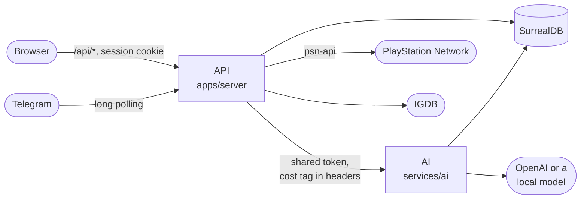

# Architecture

## Parts

| Part | Path | What it is |
|---|---|---|
| **Web** | `apps/web` | The React app players use, built to `dist/` and served by the server; Storybook and the visual and token checks live here too |
| **API** | `apps/server` | The Bun backend: the web API, the Telegram bot and the PSN watcher (`src/`), plus database scripts (`scripts/`) |
| **AI** | `services/ai` | The Python service: every prompt and model call (Nexo, guides, session plans, recommendations), embeddings, the deep guide search and the evals |
| **Database** | `db/migrations` | The SurrealDB schema, one `.surql` per table ([database](database.md)) |

Commands run from the repository root (`bun run dev`, `bun run lint`, …) and read the root `.env` ([configuration](configuration.md)).

## How they talk

- **Browser → API.** The browser only talks to the server, with a session cookie. The server also serves the web app: built files in production, Vite in development.
- **API.** Owns accounts, sessions and everything stored. Reads PSN and IGDB, and polls every player's profile on a schedule (the watcher).
- **AI.** Only the server calls it. Each call carries its cost tag (player and action), so every model call lands in `llm_call` with its tokens and price.
- **SurrealDB.** Stores everything, the guide passages and their vectors included ([database](database.md), [retrieval](rag.md)).
- **Telegram.** Long polling; the bot answers in the player's language.

## Stack

**Web** · The app players use, its components and screen checks.

[![Playwright](https://img.shields.io/badge/-Playwright-333333?style=flat&logo=data%3Aimage%2Fsvg%2Bxml%3Bbase64%2CPHN2ZyBmaWxsPSIjMkVBRDMzIiByb2xlPSJpbWciIHZpZXdCb3g9IjAgMCAyNCAyNCIgeG1sbnM9Imh0dHA6Ly93d3cudzMub3JnLzIwMDAvc3ZnIj48dGl0bGU%2BUGxheXdyaWdodDwvdGl0bGU%2BPHBhdGggZD0iTTIzLjk5NiA3LjQ2MmMtLjA1Ni44MzctLjI1NyAyLjEzNS0uNzE2IDMuODUtLjk5NSAzLjcxNS00LjI3IDEwLjg3NC0xMC40MiA5LjIyNy02LjE1LTEuNjUtNS40MDctOS40ODctNC40MTItMTMuMjAxLjQ2LTEuNzE2LjkzNC0yLjk0IDEuMzA1LTMuNjk0LjQyLS44NTMuODQ2LS4yODkgMS44MTUuNTIzLjY4NC41NzMgMi40MSAxLjc5MSA1LjAxMSAyLjQ4OCAyLjYwMS42OTcgNC43MDYuNTA2IDUuNTgzLjM1MiAxLjI0NS0uMjE5IDEuODk3LS40OTQgMS44MzQuNDU1Wm0tOS44MDcgMy44NjNzLS4xMjctMS44MTktMS43NzMtMi4yODZjLTEuNjQ0LS40NjctMi42MTMgMS4wNC0yLjYxMyAxLjA0Wm00LjA1OCA0LjUzOS03Ljc2OS0yLjE3MnMuNDQ2IDIuMzA2IDMuMzM4IDMuMTUzYzIuODYyLjgzNiA0LjQzLS45OCA0LjQzLS45ODFabTIuNzAxLTIuNTFzLS4xMy0xLjgxOC0xLjc3My0yLjI4NmMtMS42NDQtLjQ2OS0yLjYxMiAxLjAzOC0yLjYxMiAxLjAzOFpNOC41NyAxOC4yM2MtNC43NDkgMS4yNzktNy4yNjEtNC4yMjQtOC4wMjEtNy4wOEMuMTk3IDkuODMxLjA0NCA4LjgzMi4wMDMgOC4xODhjLS4wNDctLjczLjQ1NS0uNTIgMS40MTUtLjM1NC42NzcuMTE4IDIuMy4yNjEgNC4zMDgtLjI4YTExLjI4IDExLjI4IDAgMCAwIDIuNDEtLjk1NmMtLjA1OC4xOTctLjExNC40LS4xNy42MS0uNDMzIDEuNjE4LS44MjcgNC4wNTUtLjYzMiA2LjQyNi0xLjk3Ni43MzItMi4yNjcgMi40MjMtMi4yNjcgMi40MjNsMi41MjQtLjcxNWMuMjI3IDEuMDAyLjYgMS45ODcgMS4xNSAyLjgzOGE1LjkxNCA1LjkxNCAwIDAgMS0uMTcxLjA0OVptLTQuMTg4LTYuMjk4YzEuMjY1LS4zMzMgMS4zNjMtMS42MzEgMS4zNjMtMS42MzFsLTMuMzc0Ljg4OHMuNzQ1IDEuMDc2IDIuMDEuNzQzWiIvPjwvc3ZnPg%3D%3D)](https://playwright.dev)

**API** · The web API, the Telegram bot and the PSN watcher.

**AI** · Every prompt, model call, embedding and vector search.

[![OpenAI](https://img.shields.io/badge/-OpenAI-333333?style=flat&logo=data%3Aimage%2Fsvg%2Bxml%3Bbase64%2CPHN2ZyBmaWxsPSIjRkZGRkZGIiByb2xlPSJpbWciIHZpZXdCb3g9IjAgMCAyNCAyNCIgeG1sbnM9Imh0dHA6Ly93d3cudzMub3JnLzIwMDAvc3ZnIj48dGl0bGU%2BT3BlbkFJPC90aXRsZT48cGF0aCBkPSJNMjIuMjgxOSA5LjgyMTFhNS45ODQ3IDUuOTg0NyAwIDAgMC0uNTE1Ny00LjkxMDggNi4wNDYyIDYuMDQ2MiAwIDAgMC02LjUwOTgtMi45QTYuMDY1MSA2LjA2NTEgMCAwIDAgNC45ODA3IDQuMTgxOGE1Ljk4NDcgNS45ODQ3IDAgMCAwLTMuOTk3NyAyLjkgNi4wNDYyIDYuMDQ2MiAwIDAgMCAuNzQyNyA3LjA5NjYgNS45OCA1Ljk4IDAgMCAwIC41MTEgNC45MTA3IDYuMDUxIDYuMDUxIDAgMCAwIDYuNTE0NiAyLjkwMDFBNS45ODQ3IDUuOTg0NyAwIDAgMCAxMy4yNTk5IDI0YTYuMDU1NyA2LjA1NTcgMCAwIDAgNS43NzE4LTQuMjA1OCA1Ljk4OTQgNS45ODk0IDAgMCAwIDMuOTk3Ny0yLjkwMDEgNi4wNTU3IDYuMDU1NyAwIDAgMC0uNzQ3NS03LjA3Mjl6bS05LjAyMiAxMi42MDgxYTQuNDc1NSA0LjQ3NTUgMCAwIDEtMi44NzY0LTEuMDQwOGwuMTQxOS0uMDgwNCA0Ljc3ODMtMi43NTgyYS43OTQ4Ljc5NDggMCAwIDAgLjM5MjctLjY4MTN2LTYuNzM2OWwyLjAyIDEuMTY4NmEuMDcxLjA3MSAwIDAgMSAuMDM4LjA1MnY1LjU4MjZhNC41MDQgNC41MDQgMCAwIDEtNC40OTQ1IDQuNDk0NHptLTkuNjYwNy00LjEyNTRhNC40NzA4IDQuNDcwOCAwIDAgMS0uNTM0Ni0zLjAxMzdsLjE0Mi4wODUyIDQuNzgzIDIuNzU4MmEuNzcxMi43NzEyIDAgMCAwIC43ODA2IDBsNS44NDI4LTMuMzY4NXYyLjMzMjRhLjA4MDQuMDgwNCAwIDAgMS0uMDMzMi4wNjE1TDkuNzQgMTkuOTUwMmE0LjQ5OTIgNC40OTkyIDAgMCAxLTYuMTQwOC0xLjY0NjR6TTIuMzQwOCA3Ljg5NTZhNC40ODUgNC40ODUgMCAwIDEgMi4zNjU1LTEuOTcyOFYxMS42YS43NjY0Ljc2NjQgMCAwIDAgLjM4NzkuNjc2NWw1LjgxNDQgMy4zNTQzLTIuMDIwMSAxLjE2ODVhLjA3NTcuMDc1NyAwIDAgMS0uMDcxIDBsLTQuODMwMy0yLjc4NjVBNC41MDQgNC41MDQgMCAwIDEgMi4zNDA4IDcuODcyem0xNi41OTYzIDMuODU1OEwxMy4xMDM4IDguMzY0IDE1LjExOTIgNy4yYS4wNzU3LjA3NTcgMCAwIDEgLjA3MSAwbDQuODMwMyAyLjc5MTNhNC40OTQ0IDQuNDk0NCAwIDAgMS0uNjc2NSA4LjEwNDJ2LTUuNjc3MmEuNzkuNzkgMCAwIDAtLjQwNy0uNjY3em0yLjAxMDctMy4wMjMxbC0uMTQyLS4wODUyLTQuNzczNS0yLjc4MThhLjc3NTkuNzc1OSAwIDAgMC0uNzg1NCAwTDkuNDA5IDkuMjI5N1Y2Ljg5NzRhLjA2NjIuMDY2MiAwIDAgMSAuMDI4NC0uMDYxNWw0LjgzMDMtMi43ODY2YTQuNDk5MiA0LjQ5OTIgMCAwIDEgNi42ODAyIDQuNjZ6TTguMzA2NSAxMi44NjNsLTIuMDItMS4xNjM4YS4wODA0LjA4MDQgMCAwIDEtLjAzOC0uMDU2N1Y2LjA3NDJhNC40OTkyIDQuNDk5MiAwIDAgMSA3LjM3NTctMy40NTM3bC0uMTQyLjA4MDVMOC43MDQgNS40NTlhLjc5NDguNzk0OCAwIDAgMC0uMzkyNy42ODEzem0xLjA5NzYtMi4zNjU0bDIuNjAyLTEuNDk5OCAyLjYwNjkgMS40OTk4djIuOTk5NGwtMi41OTc0IDEuNDk5Ny0yLjYwNjctMS40OTk3WiIvPjwvc3ZnPg%3D%3D)](https://platform.openai.com/docs/api-reference/responses)

**Database** · Record links and vector similarity in one place ([why](database.md#why-surrealdb)).

**Quality** · Run on every pull request, with a coverage floor.

The AI service also runs on any OpenAI-compatible local server (LM Studio, mlx-lm, llama.cpp, Ollama): see [local models](configuration.md#local-models).

## Web app layout

| Folder | What goes there |
|---|---|
| `apps/web/src/ui/` | Generic pieces (buttons, states, skeletons) |
| `apps/web/src/components/` | Product components (trophy list, guide, chat, plan) |
| `apps/web/src/pages/` | Screens |
| `apps/web/src/styles/` | Design tokens and the stylesheet |

- `bun run storybook` opens every token and component with sample data on http://localhost:6006.
- `bun run ui:check` screenshots every screen at desktop and phone width into `apps/web/.ui-check/` and runs axe on each (with the app built and the database running).
- The rules for components and styles are in `AGENTS.md`.

## Plugins

An instance can add routes, checks around model work and pieces of the interface without changing the app: see [plugins](plugins.md).
