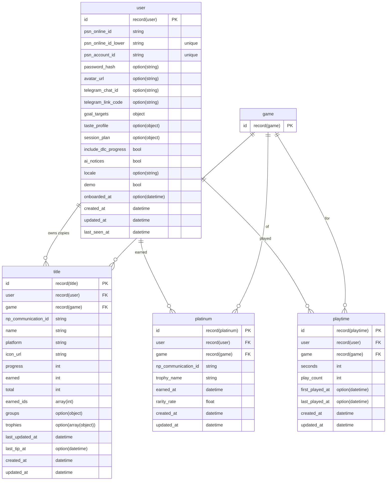
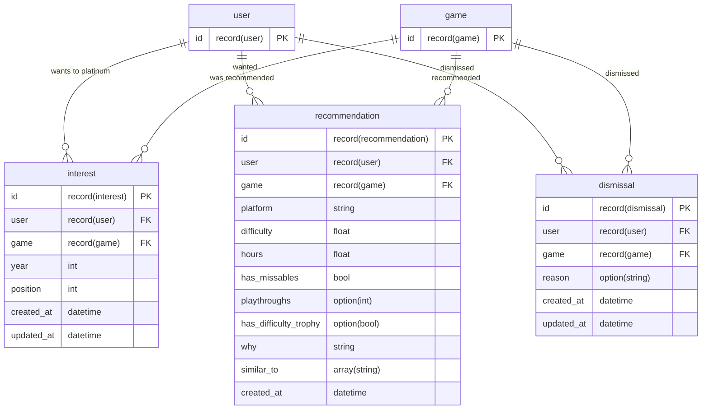
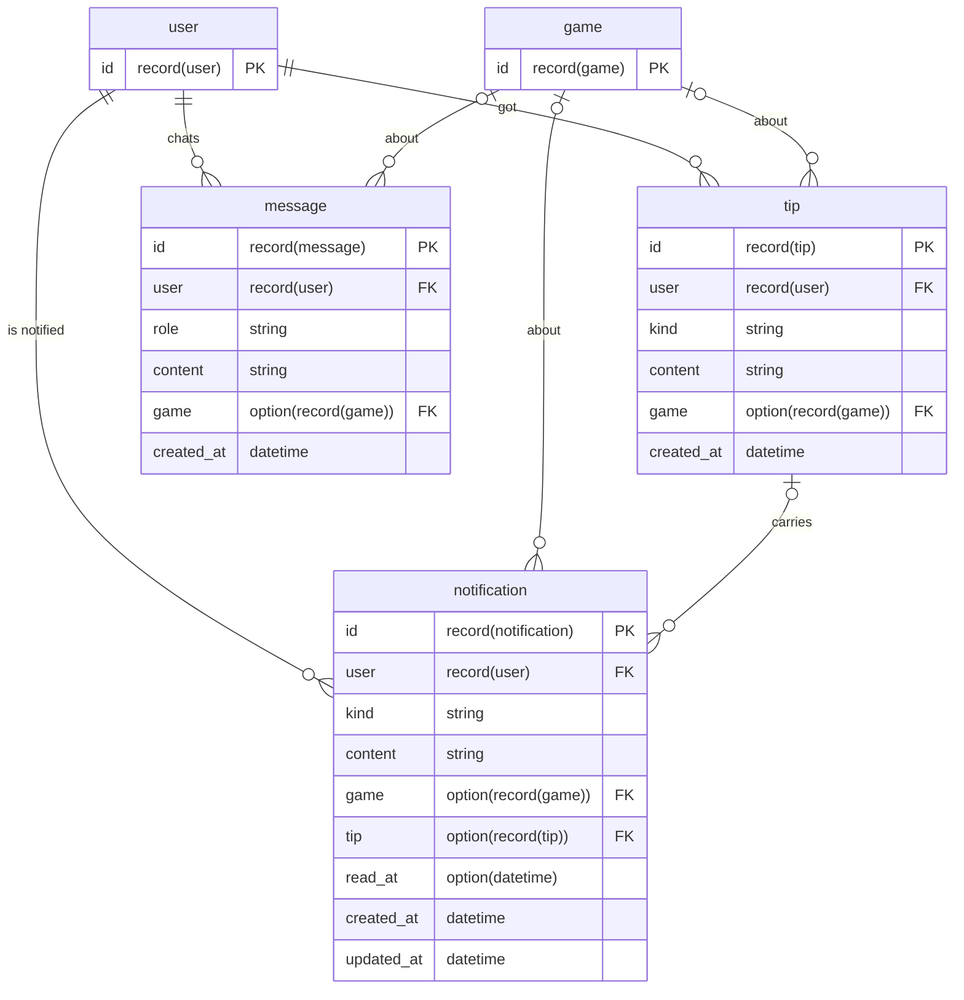
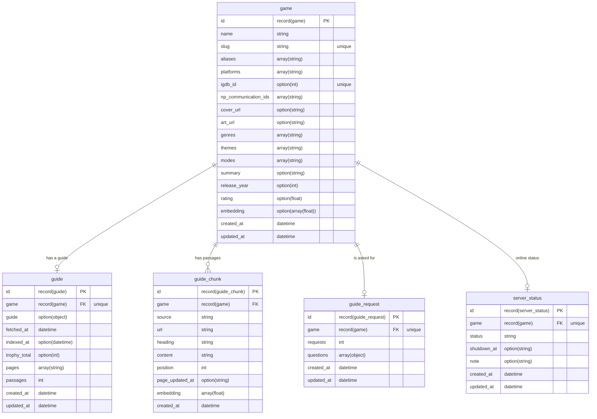
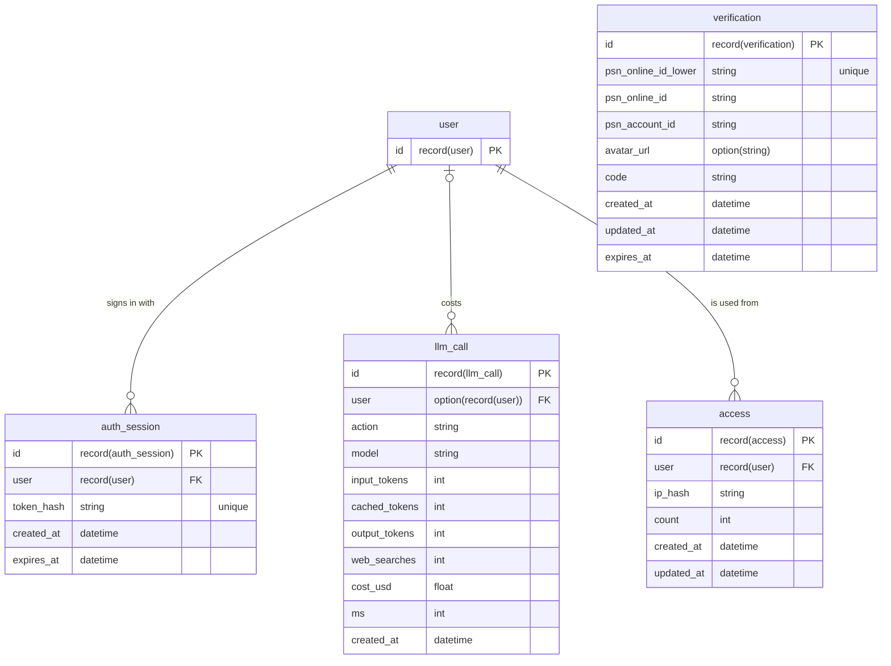

# Database

SurrealDB, one table per file in `db/migrations`. Everything stored is snake_case, the keys inside stored objects too.

Every table has `created_at`, set once by the database. Tables whose rows change after they are created also have `updated_at`, set on every write; `tip`, `message`, `guide_chunk`, `auth_session`, `recommendation` and `llm_call` are written once and keep `created_at` only. Other dates (`earned_at`, `last_updated_at`, `read_at`, `last_seen_at`) mean something of their own. Every date field ends in `_at`, the ones stored as a plain day (`YYYY-MM-DD`) too: `guide_chunk.page_updated_at` and `server_status.shutdown_at`. Links between tables are record links (`record<user>`, `record<game>`), not join tables.

## Why SurrealDB

The data is a graph with vectors in it: players, games, trophy lists, guides and passages point at each other, and Nexo and the recommendations search by meaning. SurrealDB holds both in one place ([decision 0002](decisions/0002-surrealdb.md)):

- **Record links instead of joins.** A field typed `record<game>` holds the game itself; `SELECT game.name FROM title` follows it without a join table, and `type::record($id)` turns an id from the API back into a link.
- **Vectors next to the data.** `game.embedding` and `guide_chunk.embedding` are plain arrays, compared with `vector::similarity::cosine` in the same query that filters by game or excludes what the player owns (see [retrieval](rag.md)). No separate vector store to keep in sync.
- **Schema in files, still flexible where it helps.** Tables are `SCHEMAFULL`, with types and checks (`ASSERT`) per field, defined by idempotent `.surql` files; objects that change shape with the model's output (a guide, a session plan, a trophy list) are `FLEXIBLE`.
- **One process to run.** Locally it is one Docker container; the server and the AI service talk to it over the same RPC, from TypeScript and Python.

What it costs: vectors from different embedding models do not compare, so changing the model means embedding again (`bun run embed --all`), and the Python client speaks CBOR so strings are never read as record ids.

## Diagrams

One diagram per area, with every field. Each field shows its name, then its type (`option(string)` is `option<string>`, `record(user)` is `record<user>`), and a table drawn with only its `id` belongs to another area. Arrows join a table to the record its `FK` fields point to. `verification` stands alone: it is keyed by the PSN id typed at sign-up, before an account exists.

### Players and their games

The account and what PSN says about each game in the library.

### Interests and recommendations

What the player wants to platinum next, what Nexo recommended and what was dismissed.

### Nexo, notices and chat

What Nexo wrote, the chat and the bell.

### Catalog and guides

The shared side: every player reads the same games, guides and passages.

### Sign-in, access and costs

Sessions, the pending sign-up code, where accounts are used from, and what each model call cost.

## Around the player

| Table | One row per | Unique on | Notes |
|---|---|---|---|
| `user` | account | `psn_online_id_lower`, `psn_account_id` | The PSN account id is the identity; settings, goals, the current session and plan live here as objects |
| `title` | game in the player's PSN library | `user, np_communication_id` | Progress, earned trophy ids and the trophy list snapshot from PSN |
| `platinum` | platinum earned | `user, np_communication_id` | Real unlock date and rarity |
| `playtime` | game played | `user, game` | Seconds and play count from PSN |
| `interest` | game the player wants to platinum | `user, game` | Ordered by `position`, per `year` |
| `recommendation` | game recommended | `user, game` | The latest batch, with why and what it is similar to |
| `dismissal` | game the player dismissed | `user, game` | Never recommended again |
| `tip` | notice or tip Nexo wrote | | `kind`: `start`, `unlock`, `session`, `chat` (help on one trophy), `server` |
| `message` | chat message | | `role`: user or assistant |
| `notification` | item in the bell | | Points at the `tip` it shows, when there is one |
| `auth_session` | signed-in browser | `token_hash` | Only the hash of the cookie is stored |
| `verification` | pending "About me" code | `psn_online_id_lower` | Expires; no account yet |
| `access` | address an account is used from | `user, ip_hash` | An HMAC of the IP, only with `ACCESS_HASH_SECRET` |

## Catalog and guides

| Table | One row per | Unique on | Notes |
|---|---|---|---|
| `game` | catalog game | `slug`, `igdb_id` | From IGDB; `np_communication_ids` ties it to PSN lists; `embedding` for recommendations |
| `guide` | game with a researched guide | `game` | The guide itself is an object; also the deep guide's pages and passage count |
| `guide_chunk` | passage of a deep guide | | Text, heading path, source page and its date, and the vector |
| `guide_request` | game asked for without a guide | `game` | How many times and the questions, for whoever runs the instance |
| `server_status` | game whose online servers were checked | `game` | `status`: `active`, `announced`, `closed` or `unknown`; shared by everyone, and who was already warned is in `notification` |

## Costs

| Table | One row per | Notes |
|---|---|---|
| `llm_call` | model call | Tokens, web searches, price and time, tagged with the player and action; kept without the player when the account is deleted |

## Migrations

- `db/migrations` has one `.surql` per table, applied in order by `bun run migrate` and on every server start.
- Every statement is idempotent (`DEFINE … IF NOT EXISTS`), so they run any number of times.
- Before a production database exists, a change to a table goes into that table's migration file. A database that already has the table gets the change with `DEFINE FIELD OVERWRITE`.

## Seeds and catalog

| Command | What it does |
|---|---|
| `bun run seed [path]` | Drops the database, applies the migrations and loads the demo (`db/demo-seed.json`), or another seed file (paths from the repository root) |
| `bun run db:reset [path]` | `seed`, then the catalog expansion and the embeddings |
| `bun run catalog:expand` | Pulls the game catalog from IGDB (safe to re-run) |
| `bun run embed [--all]` | Embeds the catalog; `--all` embeds every game and guide passage again, after changing the embedding model |
| `bun run build-seed [path] [--psn]` | Rebuilds `db/demo-seed.json` from the database (details below) |

`build-seed` reads the games, guides and trophy list facts from the database and makes up the player's progress from a fixed plan and a fixed day, so the same database gives the same file. Every game in the plan (top of `apps/server/scripts/build-seed.ts`) needs a guide and a stored trophy list. `--psn` also reads each game's full trophy list from PSN, so the demo shows trophies and names its unlocks.

**Personal data.** A seed with real players has chat history, PSN account ids and Telegram chat ids. `db/seed.json` is never committed: keep yours there or outside the repository. `db/demo-seed.json` is the only committed seed and has no personal data.
