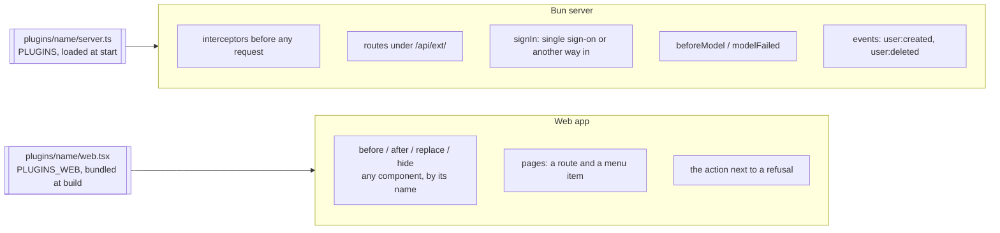

# 0008. Plugins add to an instance without changing the app

- **Status:** Accepted
- **Date:** 2026-10-04 (plugins reach any component and any request: 2026-10-14)

## Context

Instances differ in what they need around the app. One run for a group of friends wants nothing more; another wants its own integrations, rules on who can spend the model, or a page of its own. Putting every such need in the app makes it heavier for everyone who does not use it, and forking the app to add them means losing every later fix.

## Decision

An instance can load **plugins**: a folder with up to two TypeScript modules, one for the server and one for the web app, named in two settings. How to write one, with diagrams and a complete example, is in [docs/plugins.md](../plugins.md).

- **Same process, same bundle.** A plugin is not a separate app or service: its routes run in the app's server and its components render inside the app's screens, with the app's pieces (`@platjourney/web/...`) and tokens.
- **The app prepares no place for a plugin.** Every component is tagged with its name at build time and every element passes through the app's JSX runtime, which applies the plugins' rules; on the server, an interceptor can step in before any request. A plugin brings its own styles and decides when it shows, so the app never adds spacing, a slot or a hook for one plugin.
- **A versioned contract.** `PLUGIN_API` in `apps/server/src/plugins.ts` lists what a server plugin can do; on the web, the contract is the list of component names (`Target`, generated from the code).
- **Nothing changes without plugins.** With no rule every element keeps its own component, and every hook is a no-op; the default web module (`apps/web/src/plugins/none.ts`) exports no plugin.

## Consequences

- An instance adds what it needs without forking, and keeps receiving the app's fixes.
- A plugin follows the app by pinning the version it was built with; renaming a component is a change to the contract, caught by the plugin's typecheck.
- A spot inside a large component is reached by splitting it into a named component, which serves every plugin, not by adding a slot for one.
- A plugin runs with the server's permissions and the app's access in the browser: only load code you trust.
