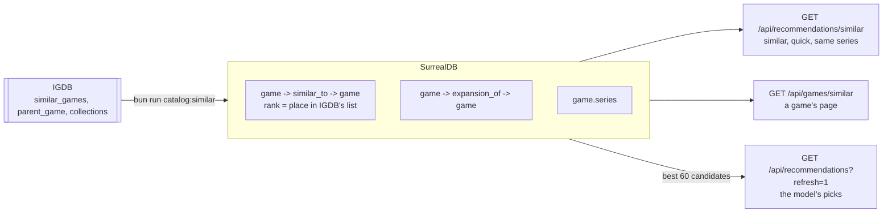

# ADR-009: Recommendations by similar games from a graph, the model's picks on demand

- **Status**: Accepted
- **Date**: 2026-10-15

## Context

The only recommendations were the model's: the AI service took the catalog games closest to the player's taste by vector and had a model pick, verify and explain them. Each batch is model work, so it is slow, it is kept for a week, and it is asked for only when the player opens Discover or refreshes it.

IGDB already says which games are alike: each game has a list of `similar_games`, its `parent_game` when it is a standalone expansion, and the `collections` (series) it belongs to. Among the catalog games with a PSN trophy list there are over 20,000 such links between games in the catalog, and almost every game with a guide has a similar game that also has a guide.

## Decision

The catalog keeps these links as a graph in SurrealDB, and the default recommendations walk it without a model.

- **Edges, not a new search.** `similar_to` and `expansion_of` are relation tables between `game` records; `game.series` holds the IGDB collection ids. `bun run catalog:similar` rewrites a game's edges, only to games in the catalog.
- **Scored in TypeScript.** The player's games are seeds, weighted by how much they say about the player (a platinum more than a game half done, a recent one a bit more). A candidate adds up the seeds that lead to it, a little for being high in IGDB's list, and more for each other player who platinumed a seed and it. Only games with a guide, not owned, dismissed or saved, that follow the player's rules are shown, each with the games of the player that led to it.
- **The model's picks stay, on demand.** Asking for a new batch still goes to the AI service, which now gets the graph's best candidates first, so the model ranks and explains games that are already close to the player's.

## Consequences

- Recommendations are free, instant and explainable ("because you played X"), and the read-only demo has them too, since nothing calls the model.
- The graph is only as good as IGDB's lists and as fresh as the last `bun run catalog:similar`; a game added to the catalog later has no edges until the script runs again.
- Games without a guide are never shown by similarity, so the guides decide how wide the recommendations reach.
