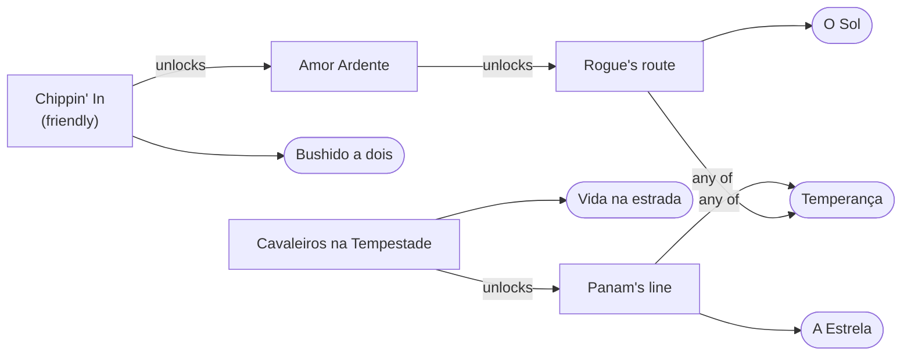

# ADR-014: Trophy dependencies as a graph inside the guide

- **Status**: Accepted
- **Date**: 2026-11-08
- **Related**: [ADR-013](ADR-013-journey-from-guide.md), [ADR-009](ADR-009-similar-games-graph.md), [Trophy journey](../design/13-journey.md#places-along-the-game)

## Context
The journey places each trophy on a line of steps (`storyline`, `trophyPlaces`) and suggests the nearest one ahead of the player. That works for games told in order, like MindsEye's 35 missions. It cannot say what a game with branching quests needs. Cyberpunk 2077's guide already describes it in prose (names as the guide writes them, in Portuguese):

- **O Sol** needs a friendly choice at the end of **Chippin' In**, which unlocks **Amor Ardente**, which opens Rogue's route. The same choice leads to **Bushido a dois**.
- **A Estrela** needs Panam's line up to **Rainha da Estrada**. Failing **Cavaleiros na Tempestade** ends that line, and with it **Vida na estrada** and **A Estrela**.
- **Temperança** needs Panam's line **or** Rogue's.
- Every ending closes at **Nocturne Op55N1**, the point of no return.

These side lines can be played in any order, so there is no "mission 13". ADR-013 turned down a graph because "the data has almost no hard dependencies". That holds for most guides, but not for games like this one.

## Decision
A guide may list dependencies as a small graph next to its places, and the journey evaluates it in TypeScript at read time, as it already does with places:

- **Nodes** are trophies (rounded) and the quests or choices that lead to them (square), named as the guide names them.
- **Three kinds of edge**: `unlocks` (A before B), `anyOf` (one of several is enough), `closes` (after it, B can no longer be earned). The drawing leaves out the `closes` edges from **Nocturne Op55N1** to the three endings, to stay readable.
- **What is done**: PSN reports trophies, not quests, so a step counts as done only when an earned trophy needed it.
- **The suggestion** goes to the step the player can do now that leads to the most open trophies (two at least), naming the nearest of them. The trophy panel lists the steps still before a trophy and the point that closes it.
- **Where it is stored**: `guide.guide.trophy_graph`, written by the content pipeline with the rest of the guide. No new table.

## Alternatives considered
- **SurrealDB relation tables** (`node -> unlocks -> node`), as ADR-009 does for similar games: this would need `trophy` and `quest` records, which do not exist today, and a rewrite of every edge whenever a guide is rewritten. The edges are read one game at a time (about 50 trophies), so a graph query brings nothing over a loop in TypeScript. It becomes the better choice if a question crosses games, for example "which trophies of my other games can I do in the same session".
- **More steps on the line** (one `storyline` per questline): this cannot express "any of" or "failing it ends".
- **Keep it in prose** (the current `missables`): the player reads it, but the route and the suggestion cannot act on it.

## Consequences
- Games with branching lines (Cyberpunk 2077, Far Cry 5's three regions, Red Dead Redemption 2's strangers) can get a route that follows what the player chose, not just the order of the phases.
- The pipeline has to extract the graph from sources that describe it in prose. A wrong edge hides a trophy or blocks the suggestion, so a guide with a graph needs a check that every trophy is reachable from the start.
- Guides without a graph keep places or the phase order, as today.
- This supersedes the "graph database" line of ADR-013's alternatives for games that have hard dependencies. ADR-013's rule that the journey is derived from the guide is unchanged.
