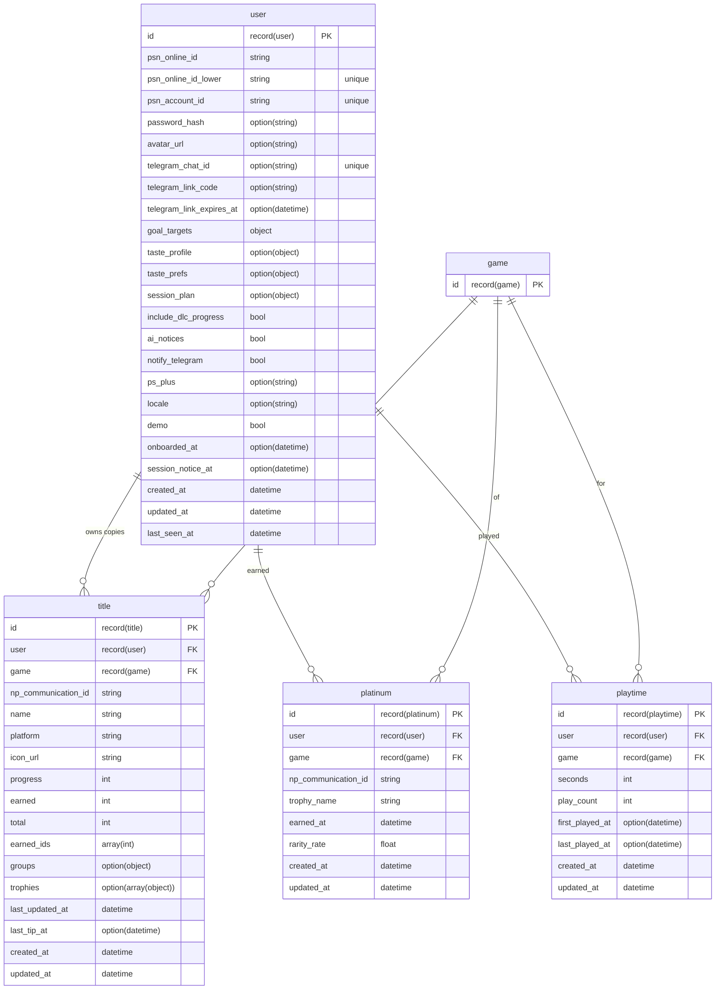
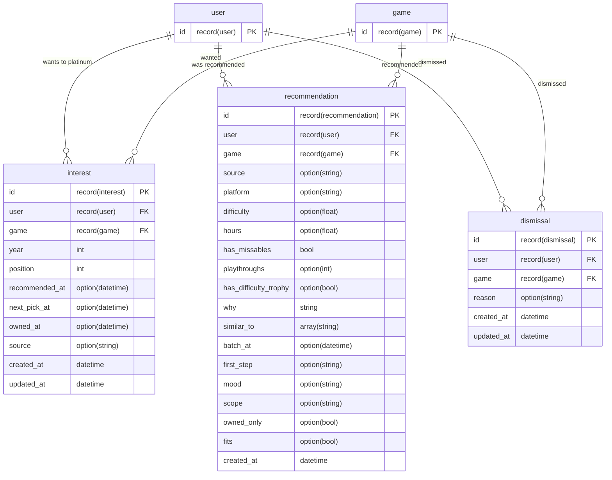
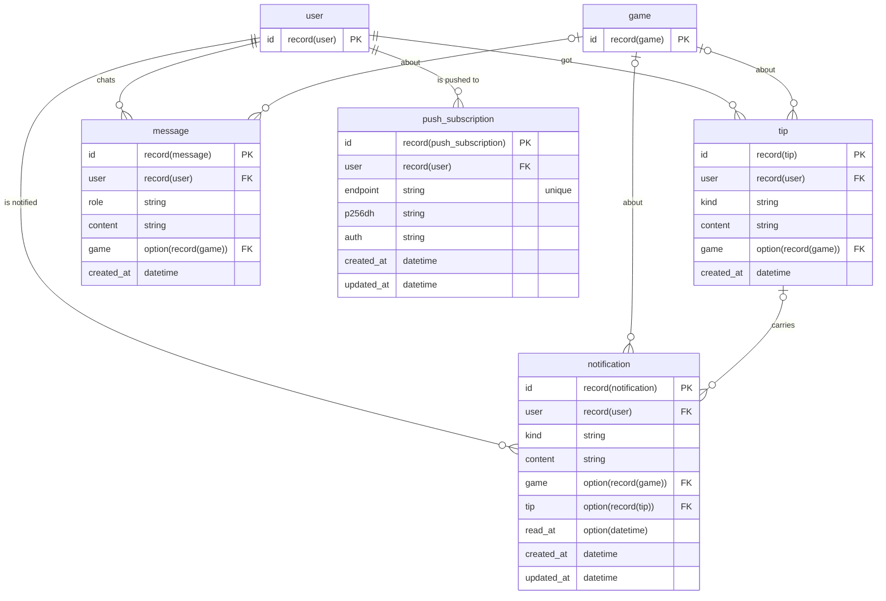
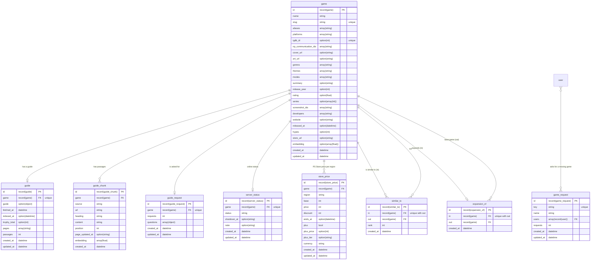
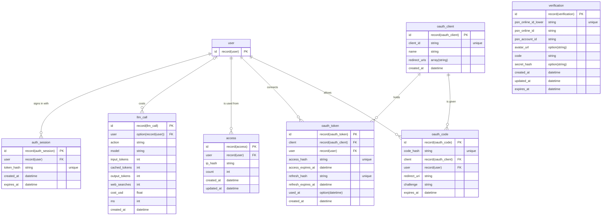

# Database

SurrealDB, one table per file in `db/migrations`. Everything stored is snake_case, the keys inside stored objects too.

Every table has `created_at`, set once by the database. Tables whose rows change after they are created also have `updated_at`, set on every write; `tip`, `message`, `guide_chunk`, `auth_session`, `recommendation` and `llm_call` are written once and keep `created_at` only. Other dates (`earned_at`, `last_updated_at`, `read_at`, `last_seen_at`, `recommended_at`, `next_pick_at`, `batch_at`, `released_at`) mean something of their own. Every date field ends in `_at`, the ones stored as a plain day (`YYYY-MM-DD`) too: `guide_chunk.page_updated_at` and `server_status.shutdown_at`. Links between tables are record links (`record<user>`, `record<game>`), not join tables; the only edges are the graph between catalog games, `similar_to` and `expansion_of` (relation tables, `game -> edge -> game`), which are written once and deleted, so they keep `created_at` only.

## Why SurrealDB

The data is a graph with vectors in it: players, games, trophy lists, guides and passages point at each other, and Nexo and the recommendations search by meaning. SurrealDB holds both in one place ([ADR-002](../decisions/ADR-002-surrealdb.md)):

- **Record links instead of joins.** A field typed `record<game>` holds the game itself; `SELECT game.name FROM title` follows it without a join table, and `type::record($id)` turns an id from the API back into a link.
- **Vectors next to the data.** `game.embedding` and `guide_chunk.embedding` are plain arrays, compared with `vector::similarity::cosine` in the same query that filters by game or excludes what the player owns (see [retrieval](07-rag.md)). No separate vector store to keep in sync.
- **Schema in files, still flexible where it helps.** Tables are `SCHEMAFULL`, with types and checks (`ASSERT`) per field, defined by idempotent `.surql` files; objects that change shape with the model's output (a guide, a session plan, a trophy list) are `FLEXIBLE`.
- **One process to run.** Locally it is one Docker container; the server and the AI service talk to it over the same RPC, from TypeScript and Python.

What it costs: vectors from different embedding models do not compare, so changing the model means embedding again (`bun run embed --all`), and the Python client speaks CBOR so strings are never read as record ids.

## Diagrams

One diagram per area, with every field. Each field shows its name, then its type (`option(string)` is `option<string>`, `record(user)` is `record<user>`), and a table drawn with only its `id` belongs to another area. Arrows join a table to the record its `FK` fields point to. `verification` stands alone: it is keyed by the PSN id typed at sign-up, before an account exists.

### Players and their games

The account and what PSN says about each game in the library.

### Interests and recommendations

What the player wants to platinum next, what Nexo recommended and what was dismissed.

### Nexo, notices and chat

What Nexo wrote, the chat, the bell and the devices that get notices as push.

### Catalog and guides

The shared side: every player reads the same games, guides and passages.

### Sign-in, access and costs

Sessions, the pending sign-up code, where accounts are used from, the assistants connected through MCP and what each model call cost.

## Around the player

| Table | One row per | Unique on | Notes |
|---|---|---|---|
| `user` | account | `psn_online_id_lower`, `psn_account_id`, `telegram_chat_id` (when set) | The PSN account id is the identity; `telegram_chat_id` is the linked Telegram chat, on one account at most (linking it takes it off any other), set from a `telegram_link_code` that works until `telegram_link_expires_at`. `session_notice_at` is when the last session-start notice went out. settings, goals, the current session and plan live here as objects. `taste_profile` is what Nexo read from the library; `taste_prefs` is what the player changed in it (genres, traits and things to avoid added or removed, and rules such as no missables or a maximum of hours). `ps_plus` is the PS Plus tier the player says they have (`essential`, `extra`, `deluxe`), since PSN does not tell. `notify_telegram` (on by default) sends notices to the linked chat; off, they reach only the web and push |
| `title` | game in the player's PSN library | `user, np_communication_id` | Progress, earned trophy ids and the trophy list snapshot from PSN |
| `platinum` | platinum earned | `user, np_communication_id` | Real unlock date and rarity |
| `playtime` | game played | `user, game` | Seconds and play count from PSN |
| `interest` | game the player wants to platinum | `user, game` | Ordered by `position`, per `year`. `recommended_at`: when Nexo last recommended the game before it was saved, set by the server and never overwritten. `source`: where the player saved it from (`releases`, the home's calendar; `recommendations`, Nexo's picks; `similar`, the lists of similar games; `title`, a game's page; `search`, the add panel), shown under the game on Interests, kept from the first save; none for older saves and Telegram. `next_pick_at`: when Nexo picked it as the next platinum on request (a pick among the interests, kept in `recommendation`), on one interest of the player at a time. `owned_at`: when the player said they already have it ("Já tenho" on a deal), for a game bought but never started, which PSN does not list yet; it is no longer shown as a deal nor in deal notices |
| `recommendation` | game Nexo recommended: in a Discover batch, or one pick asked for | | `source`: `discover` for a batch's rows (none on rows from before it, read the same), `pick` for a game picked on request (Discover's "O que jogar agora?" and `/pick` on Telegram). **Batches**: every batch of the last year, with why and what it is similar to; `batch_at` groups a batch's rows. Discover shows the latest batch; the older ones keep new batches to games not shown yet, and shown games come back, the oldest first, only when those run out. Rows from before batches were kept have no `batch_at` and count as one batch. **Picks**: one game with `why`, `first_step` (where to start), what the player asked (`mood`, in their words; `scope`, `interests` or `any`; `owned_only`, only games they have) and `fits` (false when nothing matched the mood and Nexo chose the closest); no `batch_at`, and `platform`, `difficulty` and `hours` only when known. Discover shows the latest pick and the earlier ones; asking again leaves out the games picked in the last 24 hours in the same scope. A game started within 30 days of being recommended, either way, opens its start notice glad the player followed it. Rows older than a year are deleted with the batches |
| `dismissal` | game the player dismissed | `user, game` | Never recommended again |
| `tip` | notice or tip Nexo wrote | | `kind`: `start`, `unlock`, `session`, `route` (a tip on the game's route), `chat` (help on one trophy), `server`, `deal` (a saved game went on sale) |
| `message` | chat message | | `role`: user or assistant |
| `notification` | item in the bell | | `kind`: `start`, `unlock`, `session`, `route`, `server`, `deal`. Points at the `tip` it shows, when there is one |
| `push_subscription` | browser or installed web app that turned push on | `endpoint` | Where its push service takes messages, and the device's keys (`p256dh`, `auth`) that encrypt each one. Saved again on the same endpoint moves the device to the account signed in; deleted when the player turns push off there, when the push service answers 404 or 410, and with the account |
| `auth_session` | signed-in browser | `token_hash` | Only the hash of the cookie is stored |
| `verification` | pending "About me" code | `psn_online_id_lower` | Expires; no account yet. `secret_hash` is the hash of the claim cookie: only its holder can finish the claim or get the same code again, and nobody else can replace the row until `expires_at` |
| `access` | address an account is used from | `user, ip_hash` | An HMAC of the IP, only with `ACCESS_HASH_SECRET` |

## Catalog and guides

| Table | One row per | Unique on | Notes |
|---|---|---|---|
| `game` | catalog game | `slug`, `igdb_id` | From IGDB; `np_communication_ids` ties it to PSN lists; `embedding` for recommendations. The game page's gallery and "about" card read `screenshot_ids` (IGDB image ids of its scenes, artwork when it has none), `developers`, `website` (the official site) and `released_at` (the first release day, at midnight UTC); `bun run catalog:media` fills them for games already in the catalog. `hypes` is how many people follow the game on IGDB before release: the home's calendar lists the most awaited first. `store_url` is its PlayStation Store page, where its price is read. A store edition is the game itself, its name kept in `aliases`; a PS4/PS5 remaster of a game that never came to them is its own record. `series` holds the ids of the IGDB collections the game belongs to (games sharing one are the same series), written by `bun run catalog:similar` |
| `guide` | game with a researched guide | `game` | The guide itself is an object; also the deep guide's pages and passage count |
| `guide_chunk` | passage of a deep guide | | Text, heading path, source page and its date, and the vector |
| `guide_request` | game asked for without a guide | `game` | How many times and the questions, for whoever runs the instance |
| `game_request` | name searched on Guides that neither the catalog nor IGDB had | `key` (the name normalized for search) | Who asked, each account once, and how many; for whoever runs the instance to add by hand |
| `store_price` | game someone saved in their interests, per store region | `game, region` | Its PlayStation Store price in a region (`region`, upper case; only `BR` is read today), in cents, read every day at 10:00 (Brazil time) and overwritten: price, full price, percent off, when the sale ends, whether PS Plus includes it and what members pay when the store gives them a lower price (`plus_price`), and the lowest tier whose catalog includes it (`plus_tier`). A game the player's own tier includes is a `deal` notice too, once. A new or deeper sale is a `deal` notice to everyone who saved the game |
| `similar_to` | IGDB "similar game" link between two catalog games (`in -> similar_to -> out`) | `in, out` | A relation table. `rank` is the position of `out` in IGDB's list of `in` (0 the most similar). `bun run catalog:similar` deletes a game's outgoing edges and writes them again, only to games in the catalog; the server does it at 4:30 every night for games without edges yet and for the whole catalog on Sundays, so older games also point at new ones. The recommendations by similarity walk the player's games through these edges |
| `expansion_of` | standalone expansion or episode in the catalog (`expansion -> expansion_of -> base game`) | `in, out` | A relation table, from IGDB's `parent_game` of games that add to another one (a remaster or a port is not an expansion). Written by `bun run catalog:similar`; read in both directions for the "same series" picks and a game's page |
| `server_status` | game whose online servers were checked | `game` | `status`: `active`, `announced`, `closed` or `unknown`; shared by everyone, and who was already warned is in `notification` |

## Costs

| Table | One row per | Notes |
|---|---|---|
| `llm_call` | model call | Tokens, web searches, price and time, tagged with the player and action; kept without the player when the account is deleted |

## Migrations

- `db/migrations` has one `.surql` per table, applied in order by `bun run migrate` and on every server start.
- Every statement is idempotent (`DEFINE … IF NOT EXISTS`), so they run any number of times.
- Before a production database exists, a change to a table goes into that table's migration file. A database that already has the table gets the change with `DEFINE FIELD OVERWRITE`.

## Seeds and catalog

| Command | What it does |
|---|---|
| `bun run seed [path]` | Drops the database, applies the migrations and loads the demo (`db/demo-seed.json`), or another seed file (paths from the repository root) |
| `bun run db:reset [path]` | `seed`, then the catalog expansion and the embeddings |
| `bun run catalog:expand` | Pulls the game catalog from IGDB (safe to re-run) |
| `bun run catalog:releases` | Adds the PS4 and PS5 games out in the last two weeks or in the next six, for the home's calendar; the server does it once a day |
| `bun run catalog:media [--all]` | Fills the gallery and "about" facts of catalog games that lack them, `--all` for every game (safe to re-run; holds `updated_at`) |
| `bun run embed [--all]` | Embeds the catalog; `--all` embeds every game and guide passage again, after changing the embedding model |
| `bun run build-seed [path] [--psn]` | Rebuilds `db/demo-seed.json` from the database (details below) |

`build-seed` reads the games, guides and trophy list facts from the database and makes up the player's progress from a fixed plan and a fixed day, so the same database gives the same file. Every game in the plan (top of `apps/server/scripts/build-seed.ts`) needs a guide and a stored trophy list. `--psn` also reads each game's full trophy list from PSN, so the demo shows trophies and names its unlocks.

**Personal data.** A seed with real players has chat history, PSN account ids and Telegram chat ids. `db/seed.json` is never committed: keep yours there or outside the repository. `db/demo-seed.json` is the only committed seed and has no personal data.
