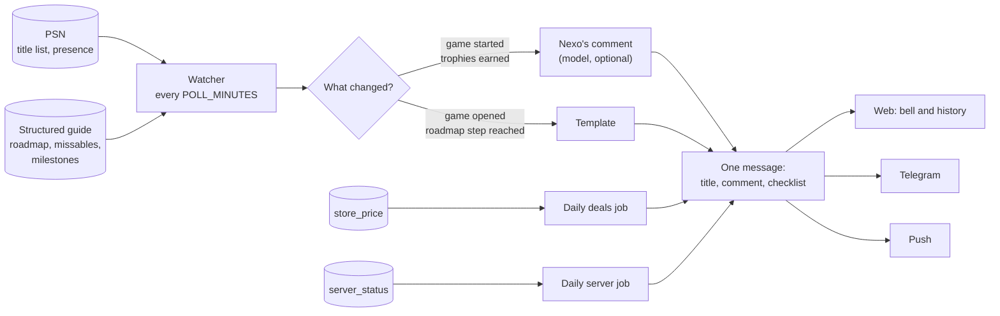

# Notifications

What PlatJourney sends a player without being asked: when each notice is sent, where it goes, what it contains, which parts are written by the model and which are not, and the rules that keep notices from repeating.

## Overview

A background job, the **watcher**, visits every player every `POLL_MINUTES` (15 by default), reads their PSN title list and compares it with the last visit. What changed decides the notice: a game started, trophies earned, a game opened. Two daily jobs add the notices about sales and about online servers shutting down.

Every notice is written to the web first (the bell and the history), then sent to the channels the player turned on: Telegram and push.

Most of a notice needs no model at the moment it is sent. The data comes from PSN and from the game's structured guide ([features](02-features.md)), which was written once, when the guide was researched. The model writes only Nexo's comment on a start or an unlock, and only when the instance and the player allow it. No notice uses the deep guide or hybrid search ([retrieval](07-nexo.md)): those serve the chat.



## Channels

| Channel | Condition | What it shows |
|---|---|---|
| Web | Always | The notice under the bell and in the history |
| Telegram | The chat is linked and "No Telegram" is on in the settings (`user.notify_telegram`, on by default) | The full notice; markdown is converted to Telegram's HTML. A message over 4,000 characters is sent in parts, cut between paragraphs so a checklist item is never split |
| Push | The device turned "On this device" on in the settings (`push_subscription`), and the instance has VAPID keys | A notification titled Nexo with the notice as plain text, cut at 900 characters; a tap opens the history |

A notice counts as read once the player opens the bell on any device, or writes anything to Nexo on Telegram (a bot never learns when a message is read, so writing is the closest sign).

Push is Web Push: each message is encrypted for the device and signed with the instance's key, with no third-party service. It works in desktop browsers, on Android and, on iPhone, only with PlatJourney added to the home screen (iOS 16.4 or later); in a Safari tab the settings explain how to add it. The native app has no push yet and says so. A channel that fails never stops the others, nor the sweep.

## Kinds of notice

| Kind | Trigger | Content | Written by |
|---|---|---|---|
| `start` | A game played for the first time, still early (under 10% of its trophies) | A welcome to the game and the first tips; the guide's note on what comes first and the first chapter's checklist | Nexo, or a template |
| `unlock` | New trophies earned since the last visit on the game being played, the first one of a game included | The trophies as the title, then Nexo's comment, a line for a missable just earned, the progress mark, the suggested next trophy, the guide's note and the next chapter's checklist when a roadmap step was reached | Nexo, or a template |
| `session` | The player opens a game (PSN presence), at most once every 6 hours | What is left for the platinum, the suggested next trophy and its tip, the checklist of the stretch the player is in, a missable still open and a trophy almost done. Opening the same game again within a day with nothing earned since gets one line (the game and the suggestion) and the checklist | Template |
| `route` | A roadmap step reached without new trophies (a sync that caught up) | The guide's note on what comes next and the chapter's checklist | Template |
| `deal` | Daily PlayStation Store check: a saved game goes on sale or its sale gets deeper, or enters the PS Plus catalog of the tier the player picked; owned games are left out | One notice a day per player: one game as a sentence (price and until when, or that it entered PS Plus), several as a list | Template |
| `server` | A game in the library has its online servers shutting down (daily check, only with `AI_RESEARCH` on) | The warning with the date and the stored note | Template |

One sweep sends at most one message per player: what happened, then what comes next, in the same text.

## Who writes what

| Part of a notice | Source | Model at send time |
|---|---|---|
| Trophy names, counts, progress, rarity | PSN | No |
| Suggested next trophy, its tip, missables, point of no return | The structured guide (roadmap, tricks, missables) | No |
| Chapter checklist (collectibles, items, missables with their steps) | The guide's milestones | No |
| Progress mark line ("Halfway through the base game: 20 of 40 trophies.") | Fixed texts, one of three picked at random per mark | No |
| Missable relief line ("🔒 **X** was missable and now it's yours for good.") | Fixed texts, one of four picked per trophy | No |
| Session, route, deal and server notices | Templates in the player's language | No |
| Nexo's comment on a start or an unlock | The model, from PSN data and the relevant parts of the structured guide | Yes, when allowed |
| Server status and its note | A daily model check with web search, stored in `server_status`; the notice reads the stored row | No at send time |

### Nexo's comment

Nexo writes the comment of a `start` or `unlock` notice when `AI_NOTICES` is on for the instance and the player kept "Notices written by Nexo" on in the profile. If either is off, a plugin refused the model work, or the model failed (quota, outage), the template is used: a player always hears about a trophy, whatever happens to the AI service.

What the model receives:

- the player's progress on the game: earned trophies (most recent first), missing ones, the guide's missables and roadmap, and the tricks and bugs of the trophies the notice is about;
- the instruction for the kind of notice: a start (what the platinum is like, three concrete tips for the first hours), an unlock (comment the trophies, keep the suggested next trophy the server chose, never pick another), a progress mark (first trophy, halfway, final stretch, platinum, each with its own ask);
- the guide's note on what comes next, when a roadmap step was reached, to say in its own words without translating names.

What it does not receive: the deep guide passages. Notices are short and about what the player just did; the structured guide covers that. Web search is available to the model when `AI_WEB_SEARCH` is on, as in the chat. The model cites no source in a notice; a source line it adds anyway is removed.

Two things are kept out of the model's hands and appended as written, because the model would shorten them: the chapter checklist and the missable relief line.

## The chapter checklist

For linear games the guide has **milestones**: one per chapter, opened by the trophy for finishing the previous chapter, with that chapter's checklist. Each item is a collectible, an item the player needs (a knife for a secret chest), or a missable trophy, with its name, the sub-chapter and objective, the steps to it and how to recover it when missed.

The checklist goes into three notices:

- **Unlock** of a chapter trophy: the next chapter's checklist, after Nexo's comment.
- **Session**: the checklist of the stretch the player is in, every time they open the game, until the trophies it counts for are earned.
- **Route**: when the step was reached without new trophies.

Format (here in English; the player gets it in their language):

```
📍 Where you are in the game
8 things to pick up here: 2 souvenirs, 2 tool chests, 2 knives, 1 secret chest and 1 flower. Plus the trophy Mercy, which is missable. In order:

1. Flower 3/5: Gentian
Sub-chapter Night work, objective "Reach the Order's ship"
• On the beach with the big ships docked, keep to the right side.
• Pick the purple flower near the end of the path.

…

7. ⚠️ Mercy: do not kill the guard at the docks
Sub-chapter Forced cooperation, objective "Reach the Order's ship"
• While he stands talking in front of you, hit him with Ignifer.
• Shoot tar at him to feed the fire and keep the rats away.
↩️ If you kill the guard or fail the escape, restart the section.
```

Rules:

- **Summary first.** The opening line counts the items by type, in the plural, and names the missable trophies, so the player knows what the chapter holds before the list.
- **Game order.** Items come in the order the player meets them; a missable sits where it happens, marked ⚠️.
- **Earned items drop out.** A tip about a trophy the player already has is not shown; a milestone with nothing left is not shown.
- **Missables by the guide's list.** A tip about a trophy the guide lists as missable is shown as missable whatever kind the milestone gave it.
- **Guides without steps.** A milestone written before the checklist format has one-line tips; they are shown with the name in bold and the directions below.
- **No "finish the chapter".** When the checklist of the next chapter is in the message, the suggested next trophy is left out if it is only that chapter's story trophy: the checklist says more.
- **A missable from a later phase is not news.** Only a missable in the roadmap phase the player is in is named as the session's missable; one planned for New Game+ waits for its phase.

## Progress marks

Some unlocks reach a point of the journey, and that notice marks it. The count is the base game without the platinum (DLC trophies do not count), and a mark fires once, on the unlock that crosses it.

| Mark | Reached when | Nexo is asked to |
|---|---|---|
| First trophy | The first trophy of the game | Welcome the player to the journey and say in one sentence how the platinum usually goes |
| Halfway | The base game passes half (for example 20 of 40) | Mark the halfway point and say what weighs most in what is left |
| Final stretch | At most 3 trophies left, or a tenth of the list on long games | List what is left by name, one per line, each with its shortest tip |
| Platinum | The platinum | Celebrate in two or three lines (rarity when rare, hours played), say goodbye to the game, point at no next trophy |

When one unlock reaches two marks (a short list), the later one wins: platinum, then final stretch, then halfway, then first trophy.

Right under the 🏆 title, the notice opens with a line in PlatJourney's own voice, one of three per mark picked at random (for example "The gates are open! One trophy after another until the platinum."). A missable just earned adds its relief line in the same place. Nexo's words follow, told not to celebrate again. The plain notice opens with the same lines, followed by a fixed line for the mark ("Halfway through the base game: 20 of 40 trophies.").

## Rules that keep it clean

- **Seen trophies are saved** after every sweep, even when Telegram fails, so the next sweep never sends or pays for the same notice twice.
- **One check per player at a time**: a sign-in and the sweep running together wait for each other, so the same unlock is not announced twice.
- **A first sync does not greet old games**: an account connected with progress already made gets no start notice for every game it has, and a title stored with trophies but no ids seen (it was never the game in front) gets no trophy notice for them. A title stored with none earned is watched: its first trophy is news.
- **The suggestion follows the roadmap's plan**: a trophy the roadmap names again in a later phase (chapter select, New Game+) is not the suggested next one while the current phase has other trophies open.
- **The trophy name shows once**, as the 🏆 title; a heading Nexo repeats is dropped, and markdown headings reach Telegram as bold.
- **The chat's game is not the game played**: `/game` and links into the chat change only the conversation; the notices follow the game PSN shows.
- **Loading a game prepares the chat**: when the watcher loads a game for a player, it also asks for the game's deep guide to be indexed, so a question about it in the chat finds passages. The notice itself does not wait for it.
