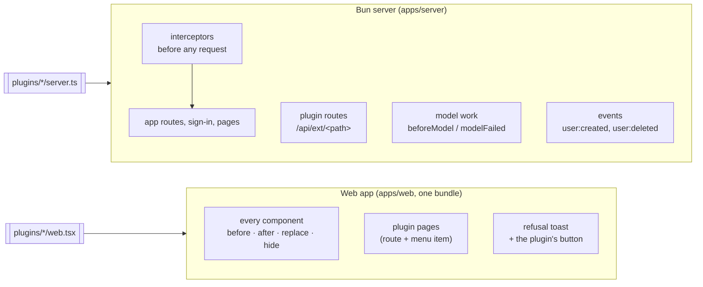
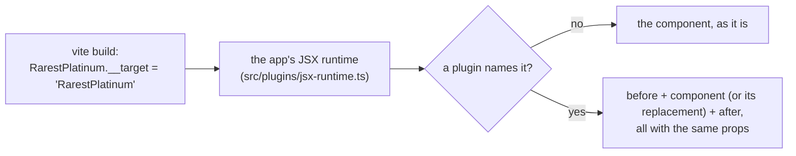
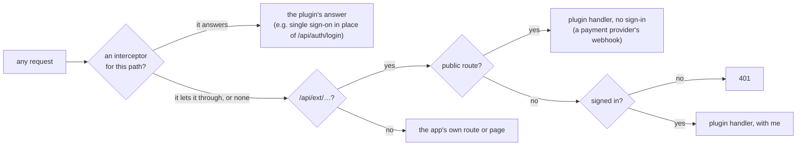
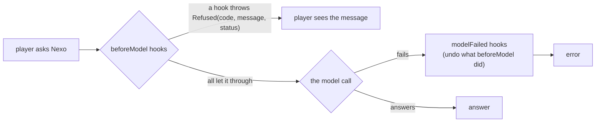
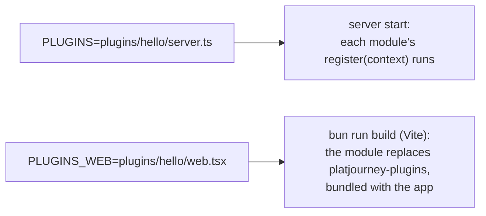

# Plugins

A plugin changes an instance without changing PlatJourney's code: a button next to any component, another way of signing in, a whole new page, a check before every model call. It is a folder with up to two TypeScript modules, one for the server and one for the web app, that the instance names in two settings. Without plugins, nothing below runs and the app is exactly the same.

The decision behind it is [ADR-008](../decisions/ADR-008-plugins.md).

**A plugin is trusted code.** It has full read and write access to the database, can sign in as any player with `ctx.signIn`, sees every sign-in and password request it intercepts, and on the web can replace any component, password fields included. The host keeps a broken plugin from taking the app down (timeouts on its hooks, an error boundary around its components, a checked page policy), not a malicious one: load only code you trust.

## What a plugin is

```
plugins/hello/
├── server.ts   ← runs inside the PlatJourney server (Bun): routes, interceptors, hooks, events
└── web.tsx     ← changes around any of the app's components, and pages of its own
```

- **The server part** is a plain module that exports a `Plugin`. It is loaded into the same Bun process as the app, at start. Everything it uses comes through the context it receives (the database, `Refused`, reading and answering JSON, signing a player in), so it imports only the app's types and can live in any folder.
- **The web part** is a plain module that exports one `PluginModule` (or a list of them): what it puts before or after any of the app's components, what it replaces or hides, whole pages (a route and an item in the menu) and the action shown when the server refuses model work. It is compiled into the same bundle as the app, so it can use the app's own pieces (`@platjourney/web/ui/states`, `@platjourney/web/lib/api`, `@platjourney/web/app/app-state`) and its CSS tokens.
- **The app prepares no place for a plugin.** Every component of the app can be reached by its name; the plugin brings its own styles (spacing included) and decides when to show itself.

## Where it runs



## How a plugin reaches any component

Nothing in the screens marks a place for plugins. At build time every top-level component of the app is tagged with its own name, and the app's JSX runtime looks each element's component up in the plugins' rules before React draws it:



| Rule | What happens | The plugin's component gets |
|---|---|---|
| `before: { Name: C }` | `C` is drawn just before every `Name` | `Name`'s props |
| `after: { Name: C }` | `C` is drawn just after every `Name` | `Name`'s props |
| `replace: { Name: C }` | `C` is drawn instead of `Name` | `Name`'s props and `original`, `Name` already rendered: show it, wrap it or leave it out |
| `hide: ['Name']` | `Name` draws nothing | |

- **Names are the contract.** `@platjourney/web/plugins` exports `Target`, every name a plugin can use, generated from the code (`bun run --cwd apps/web plugin-targets`, checked by `bun run lint`). A plugin that names a component the app renamed fails its own typecheck.
- **Two components never share a name**: the build stops and names both, so one can be renamed.
- **Finer places come from finer components.** A plugin reaches components, not lines of markup inside them. When a spot sits inside a large component, splitting it into a named component makes it reachable, for every plugin.
- **Several plugins add up** in the order the web module lists them: their `before` and `after` stack, and each `replace` receives the previous one as `original`.
- **A replacement that draws its own target** (a replaced button rendering the button) gets the app's component, not itself again.
- **A plugin's component that throws while rendering takes only itself down.** Each one sits in its own error boundary, which logs the error to the console with its place (`after Price`, `replace AuthFootnote`, `page /hello`) and draws nothing in place of a `before` or `after`, the `original` in place of a `replace`, and an error state inside the app's frame in place of a page.

## How a request reaches a plugin



A change sent to `/api/…` from another site's page is refused before any interceptor, as before any app route. The demo account is refused any method other than GET before interceptors run too (with the same `demo_read_only` answer as plugin routes), except on `/api/auth/…`, which the app itself leaves open to it. An interceptor that takes longer than 10 seconds fails that request with 500.

## How a plugin sits around model work

Every call that spends the model (chat, notices, plans, recommendations) goes through the plugins' hooks:



The hooks run one after the other. When a `beforeModel` hook refuses, the plugins whose hooks already ran get their `modelFailed` hooks, to give back what they took. A `beforeModel` hook that takes longer than 10 seconds refuses the work (`plugin_timeout`, 503), and if it finishes later after all, its plugin's `modelFailed` hooks run then.

## Building and running with plugins



Both settings are read at start (server) and at build time (web). Several server plugins are comma separated; the web side takes one module, which can export a list of plugins.

## Writing one

The server part:

```ts
// plugins/hello/server.ts
// Types only: nothing of the app is imported at runtime.
import type { Plugin } from '../../apps/server/src/plugins.ts'

const plugin: Plugin = {
  name: 'hello',
  register(ctx) {
    // GET /api/ext/hello/greeting, for a signed-in player.
    ctx.route('hello/greeting', async ({ res, me }) => {
      ctx.json(res, 200, { text: `Olá, ${me?.psn_online_id}` })
    })
    // A file at the site's root, before the app's static files.
    ctx.intercept('/hello.txt', async ({ res }) => {
      res.writeHead(200, { 'content-type': 'text/plain' }).end('olá')
    })
  },
}
export default plugin
```

The web part:

```tsx
// plugins/hello/web.tsx
import type { PluginModule, ReplaceProps } from '@platjourney/web/plugins'
import './hello.css'

// Next to the notifications bell in the top bar; its own class gives it its own spacing.
function Wave() {
  return <span className="hello-wave">👋</span>
}

// Wraps the sign-in footnote: the app's text, then a line of the plugin's.
function Footnote({ original }: ReplaceProps) {
  return (
    <>
      {original}
      <p className="hello-note">Uma instância de amigos.</p>
    </>
  )
}

function HelloPage() {
  return <div className="card">Uma página inteira do plugin.</div>
}

const plugin: PluginModule = {
  before: { Notifications: Wave },
  replace: { AuthFootnote: Footnote },
  // A page: route #/hello and an item at the end of the menu.
  pages: [{ path: '/hello', label: { 'pt-BR': 'Olá', en: 'Hello' }, icon: 'bolt', component: HelloPage }],
  // The button next to the message when the server refused model work with this plugin's code.
  refusalAction: ({ code }) =>
    code === 'hello_blocked' ? { href: '#/hello', label: 'Saiba mais' } : undefined,
}
export default plugin
```

Run it locally:

```sh
PLUGINS=plugins/hello/server.ts PLUGINS_WEB=plugins/hello/web.tsx bun run dev
```

Relative paths in both settings start at the repository's root, and absolute paths work too: a plugin can live in another checkout (`PLUGINS=../my-plugins/hello/server.ts`). Both can also go in the repository's `.env`.

## The contract

`PLUGIN_API` (in `apps/server/src/plugins.ts`) is `3`. What a plugin gets on the server:

| | |
|---|---|
| `ctx.api` | The `PLUGIN_API` version the server runs. |
| `ctx.db.q(sql, vars)` | The app's database. The plugin keeps its own tables (singular, snake_case), defined when it registers. |
| `ctx.json(res, status, body)`, `ctx.readBody(req)` | Answer JSON and read a JSON body. |
| `ctx.Refused` | The error to throw to refuse, with a code, a message for the player and a status. |
| `ctx.route(path, handler, { public, method })` | Answers `/api/ext/<path>` for one HTTP method, GET unless `method` says otherwise; any other method gets 405. A route that changes anything declares `POST` (or `PUT`, `PATCH`, `DELETE`): a link opens a GET. The handler gets `req`, `res`, `url`, `method` and, unless public, `me`. The demo account reaches only GET routes. Two plugins cannot take the same path. |
| `ctx.intercept(path, handler, { method })` | Runs before the app answers any request to `path`: exact (`/api/auth/login`, `/ads.txt`) or a prefix ending in `*` (`/api/auth/*`). The handler gets the same as a route, with `me` when signed in. If it answers, the request ends there; if not, it goes on to the next interceptor and then the app. |
| `ctx.signIn(res, user)` | Signs `user` in on this response, with the same session the app's own sign-in opens: for single sign-on or any other way in. |
| `ctx.allowOnPage(directive, ...sources)` | Lets the app's page load from more places in one directive of its content security policy (`script-src`, `frame-src`, `connect-src`, `img-src`, `style-src`, `font-src`), e.g. a provider's script and its frames. The other directives cannot be changed. Each source is checked when the plugin registers, which fails with the reason otherwise: an https host, optionally with a `*.` subdomain wildcard, a port and a path (`https://cdn.example`, `https://*.example.com/js/`), or `'self'`; `data:` also in `img-src` and `font-src`, `blob:` in `img-src`. Anything else (`'unsafe-inline'`, `'unsafe-eval'`, `*`, a bare scheme such as `https:`, `;`, `,`, spaces or quotes) is refused. |
| `ctx.beforeModel(hook)` | Runs before model work with `{ user, action }`. Throwing `Refused(code, message, status)` stops it; the player gets `message` with `status`. |
| `ctx.modelFailed(hook)` | Runs when the work failed after every `beforeModel` let it through. |
| `ctx.on('user:created', listener)` | Runs after a new account signs up. |
| `ctx.on('user:deleted', listener)` | Runs before an account is deleted. A listener that throws stops the deletion; one that takes longer than 10 seconds is logged and the next one runs. |

And on the web (`@platjourney/web/plugins`):

| | |
|---|---|
| `before`, `after`, `replace`, `hide` | Changes around any component, by its name (`Target`). See [How a plugin reaches any component](#how-a-plugin-reaches-any-component). |
| `pages` | Whole pages: `{ path, label (per language), icon, component }` become a route, an item at the end of the menu and the page title. |
| `refusalAction` | Called when the server refuses model work with `402` (a `Refused` from a plugin): returns the button shown next to the message (`{ href, label }`), or nothing. |
| `MODEL_WORK_DONE` | The event fired on `window` after the web app finished model work for the player (an answer, a plan, recommendations), so a component can refresh what it shows. |

`PLUGIN_API` goes up when the server's context changes. A plugin built for one version pins the PlatJourney version it was built with.

## Data

A plugin keeps its own data in the same SurrealDB through `ctx.db.q`. Its tables follow the app's rules (singular, snake_case) and are defined by the plugin when it registers, with `DEFINE TABLE IF NOT EXISTS`, so the app's migrations never need to know about them.

## Limits

- A plugin runs with the server's permissions and in the browser with the app's: only load code you trust (see the trust model at the top).
- Every hook (`beforeModel`, event listeners, interceptors) has 10 seconds (`HOOK_TIMEOUT_MS` in `apps/server/src/plugins.ts`). The app stops waiting then, but cannot stop the hook itself.
- An interceptor sees every matching request, the app's own included: it can answer in the app's place, so it must let through what it does not handle.
- A plugin's component receives its target's props, nothing more. What else it needs (the player, the route, the plugin's own data) it reads itself, with the app's hooks or its own routes.
