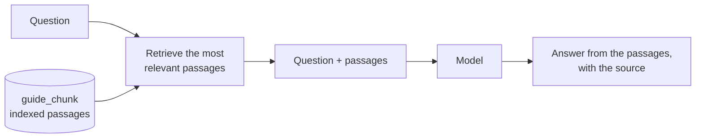
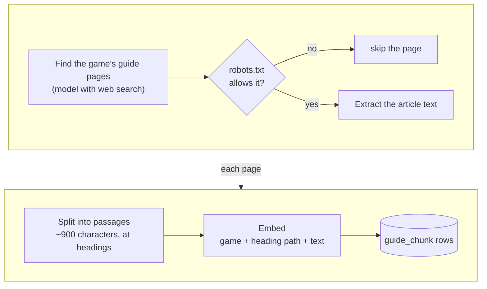
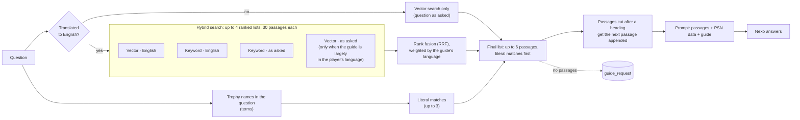
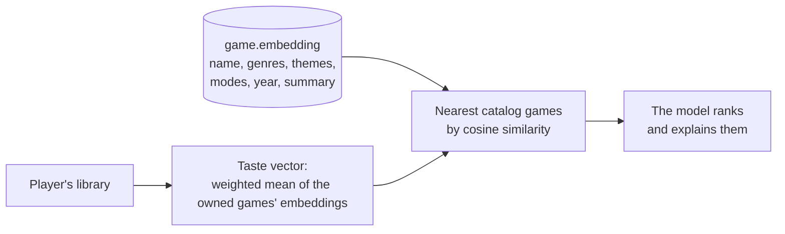

# Retrieval (deep guide)

## Overview

Nexo answers questions about a game from three sources:

1. **PSN data:** the player's progress, earned and missing trophies.
2. **The guide:** one structured guide per game ([features](02-features.md)).
3. **The deep guide:** passages from full written trophy guides, indexed per game and searched for each question. This page documents the deep guide.

The deep guide is a RAG pipeline (retrieval-augmented generation): before the model answers, the question is used to retrieve the most relevant passages from the indexed guides, and those passages go into the prompt. The model answers from them and cites the page they came from, instead of answering from its training data, which is general, old and often wrong about a game's details.

The pipeline lives in the AI service (`services/ai`); the passages live in the `guide_chunk` table in SurrealDB ([database](04-database.md)).

## Indexing

Indexing runs once per game, and again every 30 days or when the game's trophy list changes size (a DLC or an update added trophies). While a refresh runs, the previous passages keep serving answers. A game with no readable guide page is marked as failed and not retried for an hour.

| Step | Detail |
|---|---|
| Page selection | The main guide and roadmap, collectible guides and pages about a single hard trophy. Up to 10 pages when the model searches for them; any number when they are listed by hand |
| Permission | Only pages allowed by the site's `robots.txt`, fetched with a user agent that links to this repository |
| Text extraction | The page's `<article>` (or a forum's posts), without scripts, menus, headers and footers. Headings, lists and the page's last-updated date are kept |
| Passages | Split at headings; long sections split at paragraph breaks, around 900 characters each. Each passage keeps its heading path (`TEXT GUIDE > Chapter 10`) |
| Embeddings | Each passage is embedded as `game name — heading path + text` with the configured embedding model (`EMBEDDING_PROVIDER`). An embedding is a vector that represents the text's meaning; close meanings give close vectors, across languages. Every call is recorded in `llm_call` with its cost |

Each `guide_chunk` row has the game, the source site, the URL, the heading path, the text, its position in the page, the page date and the embedding.

## Retrieval

Retrieval takes the game, the question and the **terms**: the English names of the trophies the question mentions, found in the game's trophy list before the search. It returns up to 6 passages.

Guides are written mostly in English. Players ask in their own language; Portuguese is the first one supported. A search by the words of the question alone would miss most passages, so the question is translated to English first and searched in both languages.

### Hybrid search

Hybrid search is the combination of two different searches over the same passages, with their results merged:

- **Vector search** compares meanings. The question and each passage are embeddings, and the closest passages win. It finds a passage that says the same thing in other words, in any language, but it cannot tell "Virginia vinyl" from any other passage about records: an exact name is one word among many in the embedding.
- **Keyword search** compares words. A passage scores for the words of the question it contains, rare words counting most. It finds the passage that names the exact collectible, place or character, but it cannot match a synonym or another language: "vinil" never matches "vinyl".

Neither works alone for this use. The deep guide was vector-only, and the retrieval eval ([Measurements](#measurements)) showed where it failed: questions that name a specific thing. For 188 such questions the right passage was in the top 6 only 86% of the time, and in the misses it was usually a few positions below, pushed down by passages about the same topic in general.

Keyword search fixes exactly that, with two conditions:

1. **Same language.** The passages are in English and the question is not, so the question is translated before the keyword search, and the search also runs with the original words for the passages written in the player's language.
2. **Merging by rank, not by score.** A cosine similarity (0 to 1) and a BM25 score (unbounded) cannot be added. Reciprocal rank fusion merges the lists by the position of each passage, so a passage high in both lists wins, and each list is weighted by how much of the game's guide is in each language.

The result on the same eval: 95% of the questions with the right passage in the top 6, and the passage ranking higher on average (MRR from 0.64 to 0.83). On the trophy questions, 100%. Hybrid search is the normal mode; vector search alone remains as the fallback when the translation fails.

### Modes

| Mode | Condition | Searches |
|---|---|---|
| **Hybrid search** | The translation to English succeeded (the normal case) | Vector and keyword search with the English question; keyword search with the question as asked; vector search with the question as asked when at least 25% of the game's passages are in the player's language. The lists are merged with rank fusion, weighted by the guide's language |
| **Vector search only** | The translation failed (model error or timeout) | One vector search with the question as asked. This is the retrieval as it was before hybrid search |

In both modes, literal matches of trophy names come first in the final list, and the final passages are completed the same way (step 7). Hybrid search includes the vector search as one of its lists, so it never returns less than vector search only would.

### Steps

| # | Step | Mode |
|---|---|---|
| 1 | Translate the question to English | both (decides the mode) |
| 2 | Vector search | both |
| 3 | Keyword search (BM25) | hybrid |
| 4 | Weights by the guide's language | hybrid |
| 5 | Rank fusion (RRF) | hybrid |
| 6 | Literal trophy-name matches | both |
| 7 | Final list and continuation | both |

### 1. Translation

A small model translates the question to English: "onde fica o vinil da Virginia?" becomes "where is the Virginia vinyl?". The prompt asks for the translation only, with game terms as English guides name them, and returns an English question unchanged.

- Model: `AI_MODEL_SEARCH`, in the `provider:model` format of the other features. Unset, it is `gpt-5.4-nano` on OpenAI, or the local model with a local provider.
- Cost: the call runs as a step of the chat request, so it is recorded against that request.
- Cache: the last 1,000 translations are kept in memory; a repeated question is not translated again.
- Failure: retrieval runs in vector-only mode. There is no retry inside the request.

### 2. Vector search

The question is embedded with the same model as the passages, as `game name: question + terms`. The game's `guide_chunk` rows are scanned and ranked by cosine similarity between the two embeddings (0 to 1). Rows under 0.25 are dropped; the top 30 go on.

- Finds passages that say the same thing in different words, in any language: "how do I get the flower" matches "the flower is behind the tree".
- Misses exact names: "Virginia vinyl" scores about the same as every other passage about records.
- It is an exact scan, not an approximate index: a game has a few hundred passages, and the scan works with any embedding size.

In hybrid mode this runs with the English question, and with the question as asked when at least 25% of the game's passages are in the player's language (for a guide in English, the two embeddings are close enough that the second search adds nothing).

### 3. Keyword search (BM25)

BM25 is the ranking function of classic search engines. Every passage of the game is loaded once per question and scored:

- a passage scores for each query word it contains;
- rare words count more than common ones (a name that appears in two passages beats a word in two hundred);
- long passages are discounted;
- constants k1 = 1.2 and b = 0.75, the usual values;
- query words that carry no information ("onde", "fica", "where", "the") are removed first.

It finds exact names of collectibles, places and characters, and misses synonyms and other languages: "vinil" never matches "vinyl". That is why it runs twice, with the English question and with the question as asked.

The scoring runs in the service rather than in a database full-text index: a game's passages fit in memory, the scoring takes milliseconds, and SurrealDB's match operator requires every query word to be present in a passage, which is not a ranking.

### 4. Weights by the guide's language

Most guides are in English; some are mostly in the player's language. The four lists are weighted so that an English guide relies on the English searches and a Portuguese guide on the searches with the question as asked.

Each passage is classified by its common words (Portuguese is told apart from English and from Spanish), which gives the share `p` of the game's passages in the player's language. The weights are then:

- English vector and keyword lists: `2 × (1 − p)`, clamped between 0.3 and 1;
- keyword list as asked: `2 × p`, same clamp;
- vector list as asked: same as the keyword list, but 0 below `p = 0.25` (the search is not run).

| `p` (share in the player's language) | Vector · English | Keyword · English | Keyword · as asked | Vector · as asked |
|---|---|---|---|---|
| 0.05 (most games) | 1 | 1 | 0.3 | — |
| 0.30 | 1 | 1 | 0.6 | 0.6 |
| 0.50 | 1 | 1 | 1 | 1 |
| 0.90 | 0.3 | 0.3 | 1 | 1 |

Supporting another player language means adding its common words to the classifier; the rest of the pipeline is language-independent.

### 5. Rank fusion (RRF)

Reciprocal rank fusion merges the lists. Each list gives a passage `weight / (k + rank)` with `k = 60`, and the sums decide the final order. It uses ranks instead of scores because cosine similarity (0 to 1) and BM25 (unbounded) are not comparable. The constant `k` flattens the curve: rank 1 (1/61) and rank 5 (1/65) are close, rank 1 and rank 30 (1/90) are not.

Example: "onde fica o vinil da Virginia?" in a game with an English guide, for the passage "Virginia vinyl: on the shelf by the window":

| List | Rank of the passage | Weight | Contribution |
|---|---|---|---|
| Vector · English | 9 (many passages about records) | 1 | 1 / 69 = 0.0145 |
| Keyword · English | 1 ("Virginia" appears in two passages) | 1 | 1 / 61 = 0.0164 |
| Keyword · as asked | not ranked (no passage contains "vinil") | 0.3 | 0 |
| **Total** | | | **0.0309** |

A passage about another record ranked 1st by the vector search and unranked by the keyword search totals 1 / 61 = 0.0164, so the Virginia passage comes first. With vector search alone it was 9th and did not reach the prompt. The ranks are illustrative; the arithmetic is the real one.

### 6. Literal trophy-name matches

When the question mentions trophies, up to 3 passages whose heading or text contains one of their names (case-insensitive) are taken. They go ahead of the fused list in both modes: the passage that names the trophy is the right one even when the question is worded differently from the guide. The terms are also appended to the text embedded in step 2.

### 7. Final list

- Up to 6 passages: the literal matches, then the fused list (or the vector list in vector-only mode), without duplicates.
- **Continuation.** Pages are split at a fixed size, so a passage can end on a heading or a label ("Objective: Reach the South Tower", a collectible's name) with the steps in the next passage. A passage ending that way gets the next passage of the same page appended to it.
- **Dates.** Each passage goes into the prompt with its site, heading path and page date. The prompt tells Nexo to prefer the most recent passage when they disagree (games change with patches).
- **No passages.** Nexo still answers from the PSN data and the guide, and the question is stored in `guide_request`, the table of what the guides lack.

### Parameters

| Parameter | Value | Role |
|---|---|---|
| Minimum cosine similarity | 0.25 | Below it, a vector result is dropped |
| Candidates per search | 30 | Passages each search passes to rank fusion |
| Minimum list weight | 0.3 | A list never counts less than this |
| Translation cache | 1,000 | Translations kept in memory |
| BM25 k1, b | 1.2, 0.75 | Term saturation and length normalization |
| RRF k | 60 | Smoothing constant |
| Literal matches | 3 | Trophy-name passages placed first |
| Final passages | 6 | Passages sent to the prompt |

## Measurements

The `retrieval` eval ([08-evals.md](08-evals.md)) runs fixed questions and reports:

- **recall@6:** the share of questions where a passage that answers them is among the 6 returned;
- **MRR** (mean reciprocal rank): 1 when that passage is first, 0.5 when second, 0.33 when third, averaged over the questions.

Measured when hybrid search shipped, on an index covering more than a thousand games, with the questions translated by a different model from the one the service uses (so live numbers can differ slightly):

| Question set | Vector only (recall@6 · MRR) | Hybrid (recall@6 · MRR) |
|---|---|---|
| 33 questions about trophies | 0.97 · 0.72 | 1.00 · 0.84 |
| 188 questions naming collectibles, places and characters | 0.86 · 0.64 | 0.95 · 0.83 |
| 64 questions answered only by Portuguese passages | 0.89 · 0.76 | 0.92 · 0.73 |

Keyword search with the question as asked and no translation scored below vector search alone (recall@6 0.81): the common words of a Portuguese question match the wrong English passages. Fixed weights (instead of the language weights of step 4) dropped the Portuguese-passage set to 0.78 · 0.57.

## Design decisions

| Decision | Reason |
|---|---|
| Translate the question, not the passages | One short model call per question instead of translating every page; the passages keep the names the guides use |
| Exact scan, no vector index | A game has a few hundred passages; the scan is fast, exact and independent of the embedding size |
| BM25 in the service, no database full-text index | Same size argument; SurrealDB's match operator is a filter (all words required), not a ranking |
| Rank fusion instead of score mixing | Cosine and BM25 scores are on different scales |
| Weights from the guide's language | Fixed weights hurt games whose guide is in the player's language (see Measurements) |
| Literal matches first | A passage that names the trophy is the right one regardless of the question's wording |
| Continuation instead of re-splitting | Appending the next passage at retrieval time fixes headings cut from their text; re-splitting would re-embed every page |
| One embedding model at a time | Embeddings from different models are not comparable; rows with another vector size are skipped, and `bun run embed --all` re-embeds after a model change |
| Written guides only | No search results, forum threads or videos, and only pages whose site allows crawling |

## Glossary

| Term | Meaning |
|---|---|
| Passage | A piece of a guide page, about 900 characters, split at a heading |
| Embedding | A vector that represents the meaning of a text; close meanings give close vectors, across languages |
| Cosine similarity | Closeness of two embeddings, from 0 to 1 |
| BM25 | Best Match 25, the keyword ranking function of classic search engines |
| RRF | Reciprocal rank fusion: merging ranked lists by rank position |
| recall@6 | Share of questions with a correct passage among the 6 returned |
| MRR | Mean reciprocal rank: average of 1 / rank of the first correct passage |

## Recommendations: same embedding model, different flow

Recommendations ([features](02-features.md)) do not go through the retrieval above. There is no question, no translation, no keyword search and no rank fusion: it is one vector search, over games instead of passages.

| | Deep guide | Recommendations |
|---|---|---|
| What is embedded | Guide passages (`guide_chunk`) | Each catalog game, from its name, genres, themes, modes, release year and summary (`game.embedding`) |
| Query | The player's question, translated | The player's taste: a weighted mean of the embeddings of the games they own. A platinum weighs 1 to 1.5 (recent ones more), a game past 50% 0.6, past 20% 0.3, a game dropped below 20% −0.15 |
| Search | Hybrid: vector and keyword lists, fused | Vector only: the nearest games by cosine similarity, excluding owned, dismissed and already-listed games |
| After the search | Up to 6 passages into the prompt | Each candidate is annotated with the owned games it resembles, and the model ranks and explains the list |

The embedding model is the same for both, so switching it re-embeds the catalog too (`bun run embed --all`).
