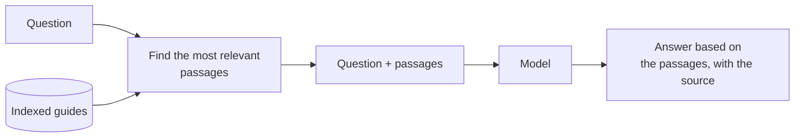
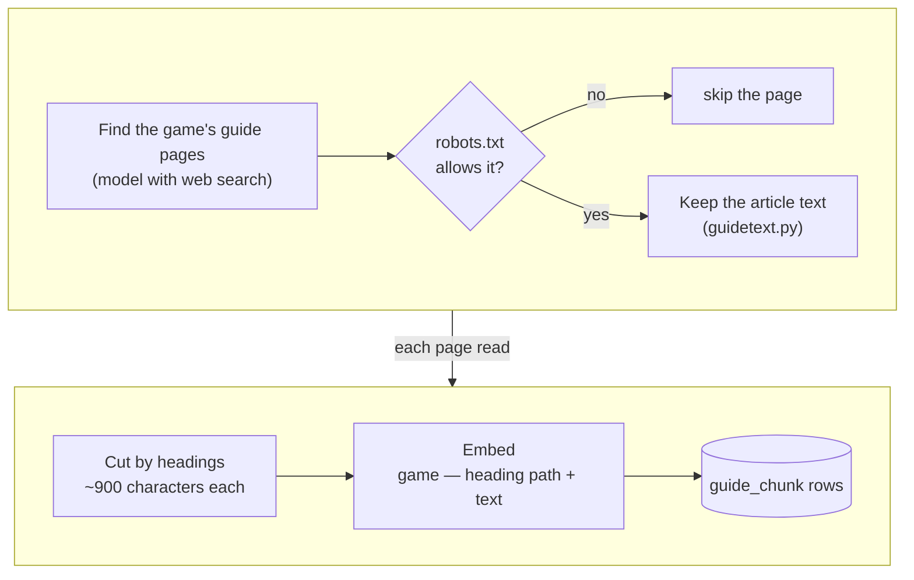
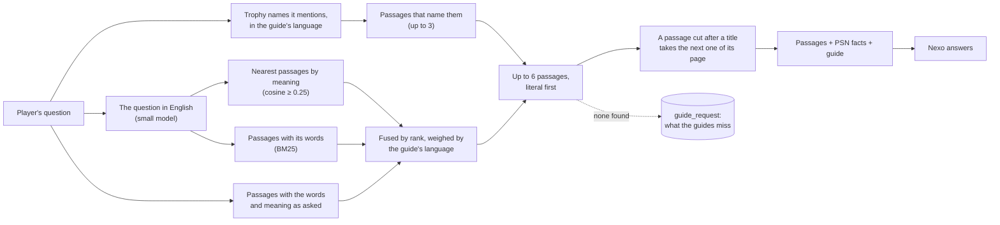
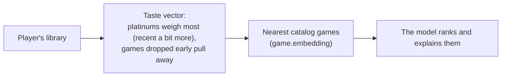

# Retrieval (the deep guide)

## What RAG is

A model only knows what it learned in training, which is general, old and often wrong about a game's details. Retrieval-augmented generation (RAG) fixes that by looking things up first: the question is used to find the most relevant pieces of text in a store we control, and those pieces go into the prompt with it. The model then answers from that text instead of from memory, and can say where it came from.

Here, the store is the deep guide, and the rest of this page is how it is filled and searched.

## In PlatJourney

Nexo answers from three things:

1. **PSN facts:** the player's progress, earned and missing trophies.
2. **The guide:** one structured guide per game ([features](02-features.md)).
3. **The deep guide:** passages from full written trophy guides, cut into pieces and searched by meaning. This page is about this one.

It all lives in the AI service (`services/ai`) and in SurrealDB ([database](04-database.md)).

## Indexing

Once per game, refreshed every 30 days or when the PSN trophy list changes size (a DLC or an update).

| Step | Detail |
|---|---|
| Pages | The main guide and roadmap, collectible guides, pages about one hard trophy: up to 10 when the model searches for them, all of them when they are chosen by hand |
| Permission | Only pages the site's `robots.txt` allows (`allowed` in `deepguide.py`), read with a user agent that links to this repository |
| Text | The page's `<article>` (or a forum's posts), without scripts, menus, headers and footers; headings and lists kept; the page's date kept |
| Passages | Cut at headings, long sections at paragraph breaks. Each passage's heading is the path above it (`TEXT GUIDE > Chapter 10`) |
| Vectors | `EMBEDDING_PROVIDER` and its model; every call recorded in `llm_call` |

While a refresh runs, the old passages keep answering. A game with no readable guide is remembered as tried.

## Answering

- **Trophy names first.** Guides are mostly in English and players often ask in Portuguese, so the trophies a question names are matched literally, in English.
- **One language for the search, weighed by the guide's.** Almost every passage is in English, so a small model (`AI_MODEL_SEARCH`, by default `gpt-5.4-nano` on OpenAI) puts the question in English first. The searches are fused by rank (reciprocal rank fusion): the vectors and the keywords (BM25 over the game's passages, which finds exact names the vectors miss, like "Virginia vinyl") of the English question, and the keywords and vectors of the question as asked. Each counts by how much of that game's guide is in Portuguese: a guide mostly in English leans on the translation, one mostly in Portuguese (about 30 games) on the player's own words, and no search counts less than 0.3. If the translation fails, the vectors rank alone.
- **A title takes its text.** A page splits into passages of a fixed size, so a passage can end on a title or a label ("Objective: Reach the South Tower", a collectible's name) with the steps in the next one. When a chosen passage ends that way, the next passage of the same page is appended to it.
- **Newest wins.** Each passage goes with its site, heading path and date; when passages disagree, Nexo trusts the most recent one (games change with patches).
- **Nothing found.** Nexo still answers from the PSN facts and the guide, and the question is stored in `guide_request`, so whoever runs the instance sees what the guides miss.

## Choices

| Choice | Why |
|---|---|
| Exact scan, no vector index | A game has a few hundred passages at most; scanning is fast, exact and works with any vector size |
| Keywords scored in the service, no full-text index | The same few hundred passages: BM25 over them takes milliseconds, and SurrealDB's match operator needs every word of the query in a passage |
| Translate the question, not the passages | One short call per question instead of translating every page; the passages keep the guides' own names |
| Rank fusion, not score mixing | Cosine and BM25 scores do not compare; a passage near the top of two lists wins |
| One embedding model at a time | Vectors from different models do not compare; rows of another size are skipped, and `bun run embed --all` re-embeds after a switch |
| Literal before semantic | The passage that names trophy X is the right one, even when the question is worded far from the guide |
| The next passage, not new chunks | Appending the following passage fixes a cut title at answer time; re-splitting every page would mean re-embedding the whole store |
| Written guides only | Never search results, forum threads or videos, and only where the site allows it |

## Recommendations use the same vectors

