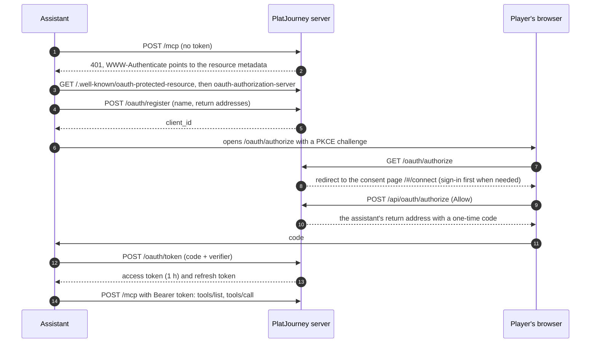

# MCP: PlatJourney in Claude, ChatGPT and other assistants

A player can connect PlatJourney to an assistant that speaks MCP and ask in plain language: "what can I still miss in Until Dawn?", "which of my games is closest to the platinum?", "save Hades to my interests". The assistant calls PlatJourney's tools for the facts (and to change the interests when asked) and writes the answer itself. The decision is in [ADR-011](../decisions/ADR-011-mcp-server.md).

## Connecting

The player adds a connector with the instance's address followed by `/mcp` (for example `https://app.example.com/mcp`): in Claude as a custom connector, in ChatGPT as an MCP server of the Streamable HTTP type. Settings → Connected apps shows these steps for Claude and ChatGPT ("How to connect", with a button that copies the address), since the instance cannot add itself to an assistant. The rest happens on its own:

- **Return addresses:** https anywhere, plain http only to `localhost`, `127.0.0.1` or `[::1]`. `/oauth/authorize` answers an unknown client or address itself instead of following it, so it cannot be used as an open redirect.
- **Codes:** one use, 10 minutes, tied to the client, the return address and the PKCE challenge (S256 only).
- **Tokens:** the access token lasts an hour; the refresh token lasts `MCP_REFRESH_DAYS` and is replaced on every use, so an old one stops working. Only their SHA-256 is stored (`oauth_token`, see [04-database.md](04-database.md#sign-in-access-and-costs)).
- **Removing the connector in the assistant:** an assistant that supports token revocation calls `POST /oauth/revoke` (RFC 7009, announced as `revocation_endpoint`) and the connection ends at once, whichever of its clients asks; each request is logged. Claude does not revoke (checked through a tunnel: removing or disconnecting the connector sends nothing), so its connection stays until it expires after `MCP_REFRESH_DAYS` (14) without use, is disconnected in Settings, or is replaced when Claude connects again (it registers two clients each time). Connecting the same assistant again (it registers anew each time) replaces its earlier connection, matched by the name it registers with.
- **Disconnecting:** Settings → Connected apps (the card that also holds Telegram) lists each assistant with its mark, when it was last used and since when. Claude and ChatGPT are recognised by the name they register with (the ChatGPT desktop app registers as Codex); any other shows a plain icon. Disconnecting deletes the token row, which ends both tokens at once. Taking over an account (claim) and deleting it end every connection too.
- **Demo:** the demo player can connect, and every read works except the deep guide; changes are refused. The shared account lists no connections.

## Tools

None calls the model: using them costs the instance nothing. The reads say so (`readOnlyHint`); the changes run the same commands as the web and Telegram, are refused for the demo, and the assistant is told to make them only when the player asks. The tools live in `apps/server/src/mcp-tools.ts`.

**Reads**

| Tool | Returns | Reads from |
|---|---|---|
| `get_profile` | PSN ID, trophy level, trophies by type, number of games | PSN profile summary |
| `get_current_game` | The game being played, progress, base-game progress, hours, the base-game trophies still missing | The watcher's current game |
| `get_trophies` | A game's list; for an owned game, what was earned. Filter `all`, `earned`, `missing` | PSN |
| `get_library` | The player's games, the latest played first, with progress, platinum and hours. Filter `all`, `in_progress`, `platinumed` | PSN, `playtime` |
| `get_next_platinums` | The player's games closest to the platinum, ranked by effort left (base game), with guide facts | The library ranking |
| `get_platinums` | The platinums with date, rarity and hours, totals by year and platform | The profile page |
| `get_interests` | This year's saved games with progress and deal, the yearly goal and this year's platinums | `interest`, PSN |
| `get_recommendations` | Games like the player's, quick platinums and the rest of their series, each with the games that led to it | The similar-games graph |
| `get_similar_games` | Games like one game: expansions, base game and series first | The similar-games graph |
| `get_releases` | PS4 and PS5 games out recently or coming soon, the most awaited first | The release calendar |
| `search_games` | Up to 10 catalog games by name, with guide difficulty and hours | The guide browser |
| `get_guide` | The stored platinum guide (roadmap, missables, online, key trophies, bugs) | `guide` |
| `search_deep_guide` | The passages that answer a question, with their source page | The AI service's retrieval (embeddings only) |

**Changes**

| Tool | Does |
|---|---|
| `add_interest` | Saves a game to this year's interests |
| `remove_interest` | Removes a saved game (`destructiveHint`) |
| `mark_owned` | Marks a saved game as already owned, so it leaves the deals |
| `set_yearly_goal` | Sets the platinums wanted this year (1 to 365) |
| `dismiss_recommendation` | Stops recommending a game, with an optional reason (`too_long`, `too_hard`, `genre`, `online`, `played`) |

**Saving what the assistant settled**

What the player and the assistant decide in the chat can live in the app too, under the assistant's name (from the name its client registered with: `Claude`, or `ChatGPT` for ChatGPT and its desktop app, which registers as Codex). The server's instructions ask the assistant to save its final pick when it recommends a game, a session plan when it makes one, and a tip when the player asks or it is worth coming back to.

| Tool | Does | Shows in the app |
|---|---|---|
| `save_suggestion` | Saves a recommended game with why, in one sentence (`assistant_pick`); the same game again updates it | Discover, "Sugeridos pelo Claude": for 30 days, until the game is saved to the interests or dismissed |
| `save_session_plan` | Saves a plan for the game being played, each step named by its trophy (steps on no trophy of the game are left out and reported) | The session plan on the current game, the same checklist Nexo's plans use, which ticks steps off as PSN reports the trophies; it replaces the plan before |
| `save_tip` | Saves a tip, with its game when named (`tip`, kind `assistant`) | History, under the assistant's name; not a notification |

A game is named by its catalog id (`game:1234`, from `search_games`) or its name; a name the catalog does not know is not looked up anywhere else. A guide that is not stored yet is not researched on the spot: the assistant can search the web with its own tools.

## Shortcuts

Three MCP prompts, which an assistant offers as shortcuts (a slash command, a menu): `what_to_play` (with an optional mood), `plan_session` (with the minutes available) and `trophy_tip` (with an optional trophy). Each tells the assistant which tools to read and how Nexo weighs the answer. That part is the same text Nexo's own prompts are built from (`services/ai/src/platjourney_ai/method.py`), asked once from the AI service (`POST /method`) and kept, so a change there changes Nexo and the shortcuts together. The assistant's model does the thinking.

## Limits and plugins

- `MCP_RATE_LIMIT` tool calls per minute per connection (60 by default); over it, the tool answers that it is busy.
- Registering is limited to 10 an hour per address, the token endpoint to 30 a minute.
- `ctx.beforeTool(hook)` runs before every tool call with `{ user, tool }`; a plugin throws `Refused` to stop it, and the assistant receives the message to pass on ([06-plugins.md](06-plugins.md)).

## Protocol

Streamable HTTP without sessions: each `POST /mcp` carries one JSON-RPC message and gets JSON back. Notifications get `202`. There is no server-sent stream, so `GET /mcp` answers `405`. Protocol versions `2025-11-25`, `2025-06-18`, `2025-03-26` and `2024-11-05` are accepted; the server answers with the client's when it knows it, else the newest. `initialize` names the server with its website and icons (`/icon-192.png`, `/icon-512.png`, on the app's dark background), and `/favicon.ico` is the same icon. Claude ignores both: its list of connectors shows the icon a favicon service returns for the address's main domain (for `app.example.com`, the site at `example.com`), so that site's icon is the one to look after. The code is in `apps/server/src/mcp.ts` and `apps/server/src/oauth.ts`.
