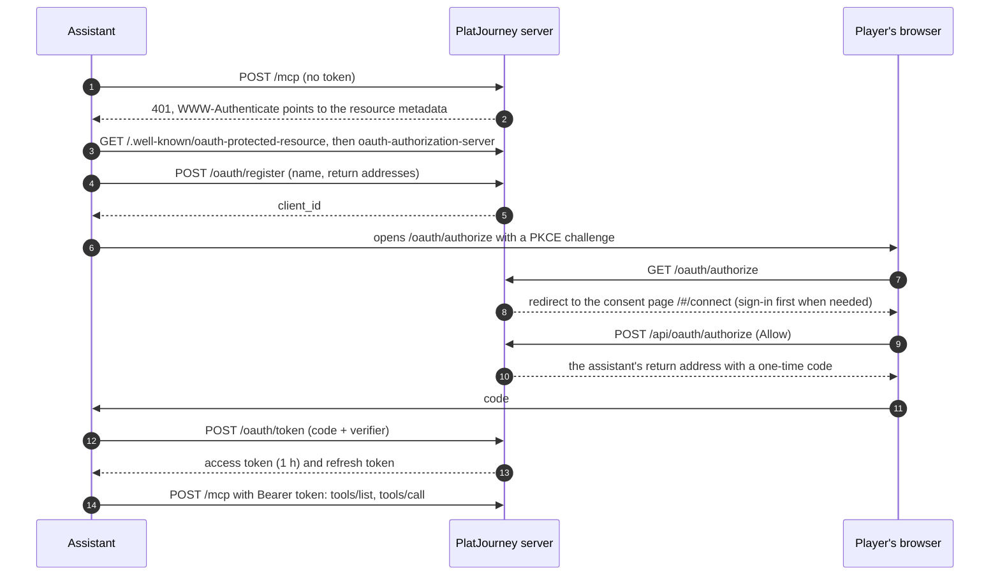

# MCP: PlatJourney in Claude, ChatGPT and other assistants

A player can connect PlatJourney to an assistant that speaks MCP and ask in plain language: "what can I still miss in Until Dawn?", "which of my games is closest to the platinum?". The assistant calls PlatJourney's tools for the facts and writes the answer itself. The decision is in [ADR-011](../decisions/ADR-011-mcp-server.md).

## Connecting

The player adds a connector with the instance's address followed by `/mcp` (for example `https://app.example.com/mcp`): in Claude as a custom connector, in ChatGPT as an MCP server of the Streamable HTTP type. Settings → Connected apps shows these steps for Claude and ChatGPT ("How to connect", with a button that copies the address), since the instance cannot add itself to an assistant. The rest happens on its own:

- **Return addresses:** https anywhere, plain http only to `localhost`, `127.0.0.1` or `[::1]`. `/oauth/authorize` answers an unknown client or address itself instead of following it, so it cannot be used as an open redirect.
- **Codes:** one use, 10 minutes, tied to the client, the return address and the PKCE challenge (S256 only).
- **Tokens:** the access token lasts an hour; the refresh token lasts `MCP_REFRESH_DAYS` and is replaced on every use, so an old one stops working. Only their SHA-256 is stored (`oauth_token`, see [04-database.md](04-database.md#sign-in-access-and-costs)).
- **Disconnecting:** Settings → Connected apps (the card that also holds Telegram) lists each assistant with its mark, when it was last used and since when. Claude and ChatGPT are recognised by the name they register with (the ChatGPT desktop app registers as Codex); any other shows a plain icon. Disconnecting deletes the token row, which ends both tokens at once. Taking over an account (claim) and deleting it end every connection too.
- **Demo:** the demo player can connect, and every tool works except the deep guide. The shared account lists no connections.

## Tools

All read-only (`readOnlyHint`). None calls the model: reads cost the instance nothing.

| Tool | Returns | Reads from |
|---|---|---|
| `get_profile` | PSN ID, trophy level, trophies by type, number of games | PSN profile summary |
| `get_current_game` | The game being played, progress, base-game progress, hours, the base-game trophies still missing | The watcher's current game |
| `get_trophies` | A game's list; for an owned game, what was earned. Filter `all`, `earned`, `missing` | PSN |
| `search_games` | Up to 10 catalog games by name, with guide difficulty and hours | The guide browser |
| `get_guide` | The stored platinum guide (roadmap, missables, online, key trophies, bugs) | `guide` |
| `search_deep_guide` | The passages that answer a question, with their source page | The AI service's retrieval (embeddings only) |
| `get_interests` | This year's saved games with progress, the yearly goal and this year's platinums | `interest`, PSN |

A game is named by its catalog id (`game:1234`, from `search_games`) or its name; a name the catalog does not know is not looked up anywhere else. A guide that is not stored yet is not researched on the spot.

## Limits and plugins

- `MCP_RATE_LIMIT` tool calls per minute per connection (60 by default); over it, the tool answers that it is busy.
- Registering is limited to 10 an hour per address, the token endpoint to 30 a minute.
- `ctx.beforeTool(hook)` runs before every tool call with `{ user, tool }`; a plugin throws `Refused` to stop it, and the assistant receives the message to pass on ([06-plugins.md](06-plugins.md)).

## Protocol

Streamable HTTP without sessions: each `POST /mcp` carries one JSON-RPC message and gets JSON back. Notifications get `202`. There is no server-sent stream, so `GET /mcp` answers `405`. Protocol versions `2025-06-18`, `2025-03-26` and `2024-11-05` are accepted; the server answers with the client's when it knows it, else the newest. The code is in `apps/server/src/mcp.ts` and `apps/server/src/oauth.ts`.
