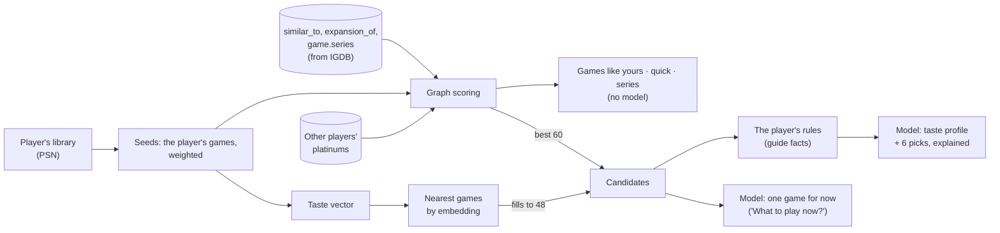

# Recommendations

How PlatJourney suggests the next platinum: which games, from which data, and when a model is involved. Three engines feed the Discover screen, the game page, "What to play now?" and the connected assistants; only one of them calls a model.

## Overview

| Engine | Data | Model | Where it shows |
|---|---|---|---|
| **Similar-games graph** | IGDB's "similar games", expansions and series, stored as relations between catalog games, plus what other players platinumed | None | Discover: games like yours, quick platinums, same series. The game page: related games. The candidates the two other engines start from |
| **Taste vectors** | An embedding per catalog game; the player's taste as a weighted mean of the embeddings of their games | Only the embedding model | Fills the candidate list when the graph leaves it short |
| **Nexo's picks** | The candidates of the two engines above, the player's library, what they dismissed and what they said about their taste | Yes: a taste profile and six explained picks | Discover, on request, kept for a week. "What to play now?" picks one game from the same candidates |

Every engine shows only games with a PlatJourney guide, never a game the player owns, dismissed or already saved as an interest, and every pick respects the rules the player set ([below](#the-players-rules)).

## The similar-games graph

### Data

The catalog keeps IGDB's relations as records in SurrealDB ([database](04-database.md)):

| Relation | Meaning |
|---|---|
| `similar_to` | IGDB's "similar games", game to game, with the rank of the target in the source's list |
| `expansion_of` | A standalone expansion and its base game |
| `game.series` | The IGDB collections (series) a game belongs to |

Only links between games in the catalog are kept. They are rewritten by `bun run catalog:similar`, which runs every night for the games that have no links yet and once a week for the whole catalog; a game added to the catalog has no links until then. Writing links is not a change to the game, so its `updated_at` is held.

### Scoring

The player's games are the **seeds**, each with a weight for how much it says about their taste:

| The title | Weight |
|---|---|
| Platinumed | 3 |
| At least half done | 2 |
| Anything else | 1 |
| Played in the last 90 days | +1 |

A seed is **strong** when platinumed or at least half done: what the player surely liked.

Every game the seeds point to through `similar_to` is a candidate, scored by:

- the weights of the seeds that point to it, added up;
- a bonus of up to 0.5 for being high in a seed's IGDB list (the first 10 count);
- 2 per other player who platinumed both a seed and the candidate.

Each candidate keeps the three heaviest seeds that led to it, which the screen shows as "because you played X", with "you platinumed X" when the player did.

### What is shown

From the scored list, after dropping games without a guide, owned, dismissed or saved games and games that break the player's rules:

| Block | Content |
|---|---|
| Games like yours | The 12 best |
| Quick platinums | Among the same candidates, the 6 best with at most 10 hours and difficulty 3 in their guide |
| Same series | Up to 6 games tied to a strong seed: its expansions and base game first, then games of the same series, by the seed's weight |

On a game's page, the related games come in a fixed order: its expansions, its base game, IGDB's similar games by rank, then games of its series, up to 6 with a guide.

Nothing here calls a model: the graph recommendations are free, instant, explainable, and the read-only demo has them too.

## Taste vectors

Each catalog game has an embedding, a vector that represents what the game is, computed once from its name, genres, themes, modes, release year and IGDB summary (`bun run embed`, `game.embedding`). The embedding model is the one the deep guide uses ([Nexo](07-nexo.md)); switching it re-embeds the catalog.

The player's **taste vector** is the weighted mean of the embeddings of their games:

| The title | Weight |
|---|---|
| Platinumed | 1, plus up to 0.5 when recent (fading over four years) |
| At least half done | 0.6 |
| At least 20% | 0.3 |
| Touched and dropped below 20% | −0.15: pulls the taste away from it |

Games outside the catalog have no embedding and cannot shape the taste. The nearest catalog games to the taste vector, by cosine similarity, are the vector candidates; each is annotated with the player's games it resembles most, among those they liked.

The vector search alone is not shown anywhere: it completes the graph's candidates when the graph has too few (a small library, a game with few links), and it did the whole job before the graph existed.

## Nexo's picks

Discover opens with Nexo's picks when the player asks for them (a button, or a refresh). A batch is model work, so it is kept for seven days and asked for again only on request; the demo player keeps its stored batch for good.

### Candidates

1. The graph's best 60 candidates for the player, excluding owned, dismissed and saved games.
2. If fewer than 48 remain, the vector search fills the rest with guided games, unseen first; games shown in earlier batches come back only when the unseen run out (a game stays "seen" for a year).
3. Games that break the player's rules, checked against their guide's facts, are dropped, and the first 24 go to the model.

### What the model sees

- The player's platinums, the 80 most recent, and the games in progress past 20%, the 30 most recent.
- The 24 candidates, each on one line with its platforms, year, genres, the player's games it resembles, and the guide's facts: difficulty, hours, playthroughs, missables, online trophies. The model must use these numbers as they are and never look anything up: there is no web search in this call.
- The games the player dismissed, with the reason when they gave one (too long, too hard, a genre they do not enjoy, online play): never to suggest, and a reason to steer away from games like them.
- What the player said about their taste: what they like, what to avoid, what an earlier profile got wrong, and their rules. It wins over anything the library suggests.

### What comes back

A JSON answer with:

- a **taste profile**: a summary citing the player's games, their genres, traits and what to avoid, in Portuguese, second person;
- **6 picks**, only from the candidate list, with variety across genres and 2 quick platinums among the 4 that match the profile, each with a "why" that references the profile and the games it resembles.

Each pick is tied back to the candidate it names; a pick naming a game outside the list is kept with no catalog link, and one whose numbers break a rule is dropped. The picks are stored as recommendations, the profile on the player, and the screen shows the profile with the player's own changes applied.

### Dismissing and preferences

- A pick can be dismissed, optionally with a reason. Dismissed games never come back from any engine, and the reasons shape the next batch. A game dismissed and then bought says nothing about the taste any more.
- The player can edit the profile: add genres, traits and things to avoid, or remove what the profile got wrong. The additions are kept apart from the model's profile, so a new batch does not overwrite them.
- Starting a game Nexo recommended within 30 days, in a batch or as a pick, opens the start notice glad the player followed the tip ([notifications](05-notifications.md)).

## "What to play now?"

The player asks for one game for right now, and Nexo answers with the game, why it fits and what to do first. This is the mood of the moment, not the taste profile.

| Choice | Options |
|---|---|
| Where to look | The player's interests (the games they saved to platinum), or any game |
| Keep to what they have | Only the library and their PS Plus catalog, or games they do not own yet |
| Mood | Something easy, short, to relax, a challenge, or their own words (up to 120 characters) |

What the model chooses from:

- **Interests:** the saved games with the guide's facts and the player's progress in each; games saved and being played this week are not options but context ("the pick is what comes after").
- **Any game:** the same candidates as Nexo's picks (graph first, vectors fill), up to 24.
- The player's last 5 platinums with their hours and difficulty: the pace and what they just went through.

The method is the shared one: a game already started is a quick win; after two long or hard platinums, something shorter; missables and online trophies (online first while servers are up); the taste; and the mood above everything, with "fits: false" and a plain word when nothing matches it. Numbers come only from the guides.

Asking again within 24 hours brings another game, until every option has been picked and the round starts over. The latest pick stays on the screen and the earlier ones open in a dialog. The pick is stored with the recommendations, so starting it is noticed too.

## The player's rules

Rules the player sets in the recommendations' preferences are checked against the guide's facts and apply to every engine, in the server for the graph and in the AI service for the picks:

| Rule | A game breaks it when its guide says |
|---|---|
| No missables | It has missables |
| One playthrough | More than one playthrough |
| No difficulty trophy | A trophy depends on the difficulty setting |
| No online | It has online trophies |
| At most N hours | More hours than N |
| At most difficulty N | Higher difficulty than N |

What the guide does not say passes: a rule never hides a game for lack of data.

## Parameters

| Parameter | Value | Role |
|---|---|---|
| Seed weights | 3 / 2 / 1, +1 recent | How much a platinum, a half-done and any other title say about the taste (graph) |
| Rank bonus | up to 0.5 over the first 10 | A seed's closest IGDB similar games count a bit more |
| Co-platinum | 2 per player | Other players who platinumed a seed and the candidate |
| Graph picks | 12 | Games like yours |
| Quick platinum | ≤ 10 hours, difficulty ≤ 3, 6 shown | Short and easy among the candidates |
| Same series | 6 | Expansions, base games and series of strong seeds |
| Graph candidates for the model | 60 | The best, before the vector search fills |
| Drawn for the model | 48, then 24 after the rules | What the model picks from |
| Picks per batch | 6, 2 of them quick | What Discover shows |
| Batch kept | 7 days | A new one only on request |
| Seen games kept | 365 days | Shown before, they come back last |
| Taste weights | 1–1.5 / 0.6 / 0.3 / −0.15 | Platinum, half done, 20%, dropped (vectors) |
| Mood | 120 characters | What the player says they feel like |
| Pick again | 24 hours | Asking again gives another game |

## Design decisions

| Decision | Reason |
|---|---|
| Graph first, model on request | Graph recommendations are free, instant and explainable ("because you played X"); a model batch is slow and costs, so it is asked for by the player and kept a week |
| The graph's candidates feed the model | The model ranks and explains games already close to the player's, instead of the whole catalog |
| Guided games only | Every pick carries the guide's numbers, so nothing is looked up or invented, and every recommendation has a guide to follow |
| Rules checked against guide facts, in code | A rule the model could forget is enforced before and after the call; the model only hears about the rules to explain the picks |
| What the player says wins over the library | A profile is a guess from behavior; a stated preference is not |
| Dismissals with a reason | "Too long" or "online" says what to avoid; a name alone only hides that game |
| Taste vector with negative weights | Games dropped early say what the player does not want |
| The mood over the profile | "What to play now?" answers a moment, not a taste |

The decision to add the graph is recorded in [ADR-009](../decisions/ADR-009-similar-games-graph.md).
