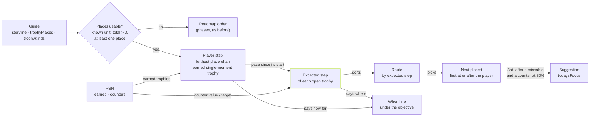

# Trophy journey

The journey is a map of a game's trophies that follows the player's progress. It reads only what every game already has: the guide (`guide.guide`) and the PSN trophy list. It stores nothing of its own, so every game with a guide has it, with no content round and no reindexing.

## Where each part comes from

| What the player sees | Source |
|---|---|
| Order of the route | `roadmap`, phase by phase, once per trophy, matched by unique exact name; with `storyline` and `trophyPlaces`, what is left goes by the step where each trophy should fall (`shared/journey/places.ts`) |
| Suggested next trophy | `todaysFocus`, the same target the session and trophy notices name |
| Tips for a trophy | `tricks`, `missables`, `onlineTrophies`, `buggy` and the `milestones` tips that name it |
| Steps that name the trophy | The lines of `roadmap.goal`, `earlyTips`, `collectibles` and general `milestones` tips that name it, at most three |
| Phase plan | `goal` of the selected trophy's first phase, in one folded block apart from the trophy's advice |
| "Throughout the journey" | Repeated in several phases or stretches, a campaign-long warning, a PSN counter above one or an early tip that names it |
| Confirmed history | Earned trophies by PSN timestamp, oldest first; undated ones grouped after them |

## How it adapts

A new sync changes the earned flags and the counters. The server recomputes the focus: a missable open in the first phase with something left, then a PSN counter at 80% or more of its target from any phase (one horde left beats the next story trophy), then, with a dependency graph, the trophy behind the step that opens the most others, then with places the nearest one ahead, then the next trophy in the guide's order. A trick does not move a trophy ahead, since a phase can span half the story. The route keeps the guide's order and marks the focus where it falls. Earned trophies leave the route's pending part and go to the history. Selecting a milestone or using the arrows never reorders anything.

Trophies do not say where the player is in the game. The route is a suggestion: it never claims a location, a save state or a guaranteed unlock order. Only PSN completes a trophy, and a full counter alone does not.

## What it does not invent

A trophy the guide does not explain shows its PSN description and the link to ask Nexo, who searches the deep guide. There is no filler text, and a phase's plan never appears as a trophy's advice. A one-word name only counts as a mention in bold, since it may be an ordinary word, and a step or a line of the phase plan that names a trophy still hidden stays out. A name that matches more than one trophy stays out of the route's phases. DLC stays on its own track, outside the platinum route. Hidden trophies keep their name, art and tips protected until the player reveals that game's hidden trophies, a choice saved per account in `user.revealed_trophy_games`.

## Coverage

Measured on 2026-11-04 on a local copy of 1,137 guides, dated 2026-10-21, against their official trophy lists. Production has newer guides, so these numbers are a floor for checklist content.

| Measure | Result |
|---|---|
| Base trophies with a place on the route | median 100%, 99.5% of all trophies |
| Trophies with a tip of their own | 40% |
| Trophies with no tip, but named in a guide step | 36% |
| Trophies with neither, mostly story ones | 24% |
| Share of a game's trophies with specific text | median 84%; 48% at the 10th percentile, 100% at the 90th |
| Route plus tips on at least 40% of trophies | 421 games |
| Route with fewer tips | 483 games |
| Only phases, fewer than 3 story milestones | 226 games |
| Fewer than 90% of trophies placed | 7 games |

The share of trophies with specific text is what a content round can raise: it needs the writing step only, since the passages are already indexed.

## Places along the game

A guide can say where each base-game trophy sits along the game. Two optional fields carry it:

- `storyline`: what one step of the game is and how many there are, as `{ unit: "mission", total: 35 }`. The unit is one of `mission`, `chapter`, `episode`, `act` or `level`; the app names it in the player's language. `order: "free"` marks a game whose steps can be played in any order (see "Games played in any order").
- `trophyPlaces`: for each trophy, the step where it unlocks (`from`) or, for a count or a collection, the range it is worked on (`from`, `to`). A step past `total` is after the story (mission select, free roam).

With them, the journey is a line of steps. The player is a point on it, each open trophy is another point, and the route and the suggestion read the distance between them. The code is `shared/journey/places.ts`; the server's focus and the web map call the same functions.

- **Where the player is**: the furthest `from` among the earned trophies of a single moment. A count can close anywhere, so it does not count. A trophy keeps going when its place has `to > from`, its kind is `grind`, or PSN gives it a counter above one. It is an estimate, never a claim about the save.
- **Where an open trophy falls**: a trophy of a single moment, where it unlocks. A count, where its PSN counter reaches the target at the pace so far: `pace = value / (player − from + 1)`, then `player + ⌈(target − value) / pace⌉`, never before the player nor its own start, and `total + 1` (after the story) when that pace would not close it in time. With no counter or no pace yet, where players usually earned it, else halfway through its range (its start when the guide gives only a start). A trophy the guide does not place: where players usually earned it, else at the story trophy with the closest PSN rarity, else after the story ([ADR-016](../decisions/ADR-016-route-by-expected-unlock.md)). Before players, a model's estimate stands in for halfway and for the rarity (see "Before players"). Step 0 is the start of the game, before step 1.
- **The route** orders what is left by that step, a trophy of the moment before a count on the same step. A trophy the guide does not place goes where it is expected too, never by its spot in PSN's list.
- **The suggestion** is a missable of the current phase first, then a counter at 80% or more of its target, then the nearest placed trophy at or after the player's step. With nothing ahead, the first one left behind.
- **The when line** under a trophy's objective says it in plain words: "You earn it by following the story, in mission 31.", "You can work on it from mission 12 to 30.", "You can start it in chapter 3.", "At your pace, it closes in mission 16.", or "Happened in chapter 1, which is behind you." The replay hint only appears when the guide mentions mission or chapter select.

### Where players earned it

Guides say where a long trophy (a count, a collection, an upgrade) starts, almost never where it closes, and some trophies they do not place at all. Both are worked out from players' unlock times ([ADR-015](../decisions/ADR-015-trophy-steps-from-players.md), [ADR-016](../decisions/ADR-016-route-by-expected-unlock.md)): every sync keeps each earned trophy's PSN time in `unlock`. For each player, their placed story trophies are marks in time; a trophy earned between two marks gets a step in proportion to the time, one earned before the first grows from 0 since their first unlock, and one earned after the story's last step is after the story. The median over at least 3 players becomes the trophy's step (`trophySteps`, added when the guide is served, `shared/journey/places.ts` `closingSteps`), never before the guide's start. The panel says "Players who did it usually close it in chapter 7 (12 players)", or for a trophy the guide does not place, "Players who did it usually get it at the start of the game (13 players)". The player's own PSN counter still projects at their pace.

The panel never says how far a trophy is from the player: their trophies only say where they have been at least.

### Before players

A game with fewer than 3 players has no `trophySteps`. For it, the AI service asks a decision model (Jev, typesafe.ai) where each trophy without a single moment is usually earned, as a choice over the steps, from the guide's story trophies and the trophy's text, range and rarity ([ADR-017](../decisions/ADR-017-predicted-steps.md)). The expected step is stored with the guide as `predictedSteps`. The order of what decides a step is: players (3 or more), then the estimate, then halfway through the range or the rarity. The panel never quotes the estimate: "Players who did it usually…" stays for players' data only.

The server asks in the background the first time it serves a guide with places and no estimate (at most once an hour per game); saving the guide again drops it. Without `TYPESAFE_API_KEY` nothing is asked. Measured against players on 34 games, the estimate missed by 19% of the story against 27% for halfway and rarity.

### Games played in any order

With `storyline.order: "free"` (bosses, worlds or regions in any order), the guide's steps are the usual order, not a fixed one. The player's place is how many steps they have done, not the furthest; a step they skipped is never "behind"; the suggestion is the first open trophy in the route; and players' marks count steps done. Without the flag, beating a late boss first would put the player past every boss they skipped.

### An example

A campaign of 35 missions. The player earned the trophies of missions 10 and 12, so the player step is 12.

| Trophy | Place | PSN counter | Expected step | Why |
|---|---|---|---|---|
| Príncipe | 13 | | 13 | Single moment: where it unlocks |
| Café | 16 | | 16 | Single moment |
| Golpe Final | 12 to 30 | 0 / 50 | 21 | No pace and no players yet: halfway through its range |
| Golpe Final | 12 to 30 | 10 / 50 | 16 | 10 in 1 mission: 4 more missions |
| Golpe Final | 12 to 30 | 1 / 50 at mission 14 | 36 | Too slow: after the story |
| Paus e Pedras | 3 to 33 | | 18 | A collection with no counter: halfway through its range |
| Sacrifício | 35 | | 35 | Single moment |

The route reads Príncipe, Café, Paus e Pedras, Golpe Final, Sacrifício, and the suggestion is Príncipe. With Golpe Final at 10 / 50 it moves up to 16, right after Café (the trophy of the moment goes first on the same step).

### Without places

Guides without `storyline` and `trophyPlaces`, or with a unit the app does not know, keep the roadmap's order and the focus rule in "How it adapts". The only visible change there is that a natural trophy with no tip reads "You earn it by following the story." under its objective.

## Dependencies between trophies

Some games hang their trophies on branching lines played in any order, where a line of steps cannot say what comes first. For those, a guide can carry `trophyGraph`: `nodes` (quests, choices and trophies, named as the guide names them) and `edges` of three kinds. The decision is [ADR-014](../decisions/ADR-014-trophy-dependencies.md); the code is `shared/journey/graph.ts`.

| Edge | Means | Example (Cyberpunk 2077) |
|---|---|---|
| `unlocks` | `to` needs `from` | Amor Ardente unlocks Rogue's route |
| `anyOf` | `to` needs one of its `anyOf` parents | Temperança needs Panam's line or Rogue's route |
| `closes` | once `from` is done, `to` can no longer be earned | Nocturne Op55N1 closes the endings |

- **What is done**: PSN only reports trophies, never quests. A step counts as done when an earned trophy needed it; a trophy with several `anyOf` parents does not say which one was taken, so none is marked.
- **The trophy panel** lists the steps still before an open trophy, nearest the start first, and the point that closes it: "First, go through Amor Ardente and Rogue's route. Only until Nocturne Op55N1." When that point has passed and the trophy is still open: "Not in this save anymore: Nocturne Op55N1 has passed."
- **The suggestion**: among the steps the player can do now, the one that leads to the most open trophies, two at least. It names the nearest of those trophies, so the player gets something earnable. It comes after a missable in the open phase and a counter at 80% or more, and before places.
- **The route order** does not change with a graph: it keeps places or the phase order.

A graph the app cannot read (an edge to a node it does not list, an unknown kind) is ignored as a whole.
