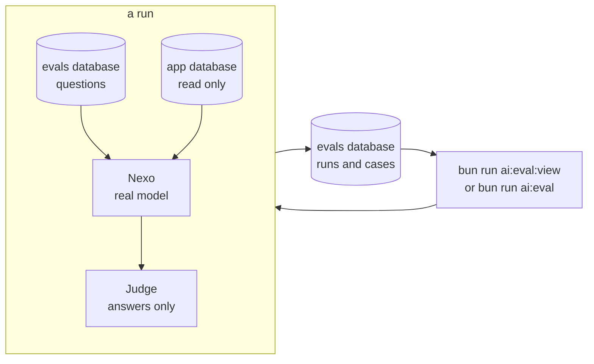

# Evals

Evals measure Nexo against fixed questions with the real model and the real guides, so a change to a prompt, a model or the retrieval shows up as a number before it reaches players. Every run is stored with the platform version, and the viewer runs suites, compares runs case by case and edits the questions.



## Suites

| Suite | What it measures | Passes when | Cost per question |
|---|---|---|---|
| `retrieval` | Whether the deep guide search brings a passage that answers the question | A relevant passage is among the top 6 (recall@6, MRR) | Embeddings, a fraction of a cent |
| `scope` | Whether Nexo stays on PlayStation and keeps its rules when asked not to | The reply is short and says nothing from `forbidden` | One chat call |
| `answers` | Whether Nexo's answer about a game is right, on point and about what the player still lacks: how to get a trophy, missables, collectibles, time and difficulty, online, points of no return, PS4 and PS5 lists, where to start | The judge scores it 4 or 5 out of 5, with nothing from `avoid` | ~US$ 0.02 (answer and judge) |

```bash
bun run ai:eval seed         # first: load the example questions into the evals database
bun run ai:eval:view         # the viewer on http://127.0.0.1:8200: run, compare, edit questions
bun run ai:eval              # every suite from the command line
bun run ai:eval answers      # one suite
```

## The viewer

| Part | What it does |
|---|---|
| Suites | One card per suite with how many questions it asks and the estimated cost of a run (from the last run, or a default). **Run** asks for confirmation with that cost, then follows the run live. |
| Runs | Every run, newest first, with version, commit, models and cost. A run opens case by case (question, expected, Nexo's answer, score and why) and compares with an earlier run of the same suite: each case is marked fixed, broke, better or worse. |
| Questions | Each suite's questions, to add, edit or archive. An archived question is no longer asked; earlier runs keep its cases. |

It listens on 127.0.0.1 only and has no login: run it on your own machine.

## Where it stores

Questions and runs live in a database of their own, `evals` by default, on the same SurrealDB as the app: the history is backed up with everything else, and the app's database is only read. On first use the database and its tables are created (`services/ai/evals/schema.surql`). `bun run ai:eval seed` copies in the example questions from `services/ai/evals/data/`: run it before opening the viewer the first time, and again when the repository brings new examples. It only adds the questions a suite does not have yet (matched by their text), so questions edited or archived in the viewer stay as they are.

| Table | Holds |
|---|---|
| `eval_question` | A suite's question: `suite`, `data` (its fields, below) and `active` |
| `eval_run` | A run: `suite`, `status` (running, done, failed), `version` (root `package.json`), `commit` (`+` when the tree had uncommitted changes), `prompt` (a fingerprint of the prompts used), `models`, `cost_usd`, `passed`, `total`, `planned` and `summary` |
| `eval_case` | One question in a run: `input`, `expected`, `output`, `passed`, `score`, `reason`, `models`, `cost_usd` and `extra` (the game, the judge's flags) |

A question's `data` per suite:

| Suite | Fields |
|---|---|
| `retrieval` | `game` (record id), `name`, `question`, `terms` (English trophy names), `relevant` (keyword groups; a passage is relevant when it has every keyword of one group) |
| `scope` | `message`, `forbidden`, `max_chars` |
| `answers` | `game` (catalog name), `question`, `reference` (the guide's answer), `earned` (trophies the player has), `avoid` (what a good answer must not say) |

An eval writes nothing to the app's database: its model calls are collected in memory instead of `llm_call`, and its questions never reach the guide request queue.

## The answers suite

Nexo answers with the game's stored guide, deep guide passages and trophy list, as a player who has earned only the trophies in `earned`. The judge model (`AI_MODEL_JUDGE`, the default model when unset) scores the answer from 1 to 5 against `reference` and checks it says nothing from `avoid`, such as advice for a trophy the player already has. A game nobody on the instance owns has no stored trophy list: Nexo then answers from the guide and its passages alone, and the case records `trophy_list: false`.

## Which models

The evals use the AI service's model settings, as the app does: `AI_PROVIDER`, `AI_MODEL_CHAT` for Nexo, `AI_MODEL_JUDGE` for the judge (the default provider when unset) and the embedding settings for the guide search. A local model needs its server up, or a run stops at the first question. The embedding model must be the one the database's passages were indexed with, or the guide search compares vectors that do not match.

## Pointing at a database

The suites read guides through the AI service's settings (`SURREAL_URL`, `SURREAL_USER`, `SURREAL_PASS`, `SURREAL_NS`, `SURREAL_DB`) and keep their questions and runs through `EVAL_SURREAL_*`, which fall back to the same values with the `evals` database. To measure against an instance's real guides, use a user that can only read its `main` database and write its `evals` database:

```bash
SURREAL_URL=… SURREAL_USER=eval SURREAL_PASS=… bun run ai:eval:view
```

Such a user cannot create the `evals` database: create it once with an owner, then define the user with `ROLES VIEWER` on `main` and `ROLES EDITOR` on `evals`.
