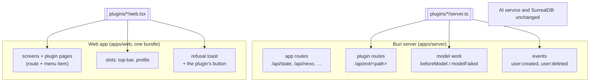
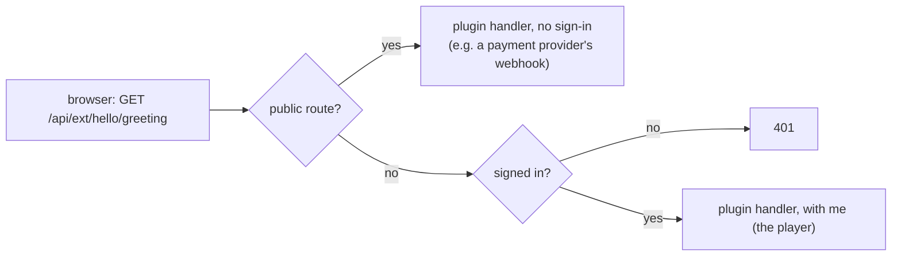
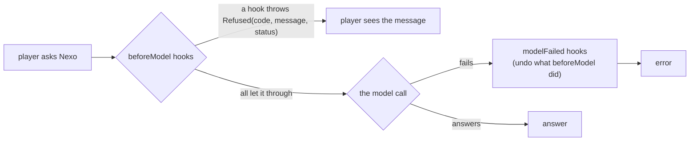
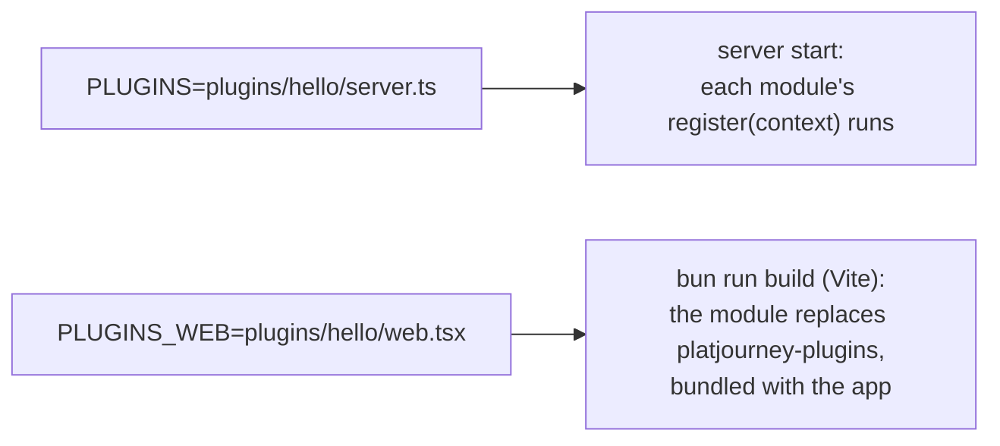

# Plugins

A plugin adds to an instance without changing PlatJourney's code: new API routes, a check before every model call, a card on the profile page. It is a folder with up to two TypeScript modules, one for the server and one for the web app, that the instance names in two settings. Without plugins, nothing below runs and the app is exactly the same.

The decision behind it is [ADR 0008](decisions/0008-plugins.md).

## What a plugin is

```
plugins/hello/
├── server.ts   ← runs inside the PlatJourney server (Bun): routes, hooks, events
└── web.tsx     ← React components the web app shows in its slots
```

- **The server part** is a plain module that exports a `Plugin`. It is loaded into the same Bun process as the app, at start. Everything it uses comes through the context it receives (the database, `Refused`, reading and answering JSON), so it imports only the app's types and can live in any folder.
- **The web part** is a plain module that exports what the plugin adds to the interface: components for named slots, whole pages (a route and an item in the menu) and the action shown when the server refuses model work. It is compiled into the same bundle as the app, so it can use the app's own pieces (`@platjourney/web/ui/states`, `@platjourney/web/lib/api`, `@platjourney/web/app/app-state`) and its CSS tokens.
- **There is no separate app or service.** A plugin's API runs in the app's server, under `/api/ext/`, and its components render inside the app's screens.

## Where it runs



## How a request reaches a plugin



Routes the app already has are never handed to plugins: only paths under `/api/ext/` are.

## How a plugin sits around model work

Every call that spends the model (chat, notices, plans, recommendations) goes through the plugins' hooks:



## Building and running with plugins



Both settings are read at start (server) and at build time (web). Several server plugins are comma separated; the web side takes one module, which can gather the slots of several plugins.

## Writing one

The server part:


The web part:

```tsx
// plugins/hello/web.tsx
import { useEffect, useState } from 'react'
import type { PluginModule } from '@platjourney/web/ui/plugin-slot'
import { api } from '@platjourney/web/lib/api'

function Greeting() {
  const [text, setText] = useState('')
  useEffect(() => {
    api<{ text: string }>('/api/ext/hello/greeting').then((r) => setText(r.text)).catch(() => {})
  }, [])
  return text ? <div className="card">{text}</div> : null
}

function HelloPage() {
  return <div className="card">Uma página inteira do plugin.</div>
}

const plugin: PluginModule = {
  // Components in the app's slots.
  slots: { profile: Greeting },
  // A page: route #/hello and an item at the end of the menu.
  pages: [{ path: '/hello', label: { 'pt-BR': 'Olá', en: 'Hello' }, icon: 'bolt', component: HelloPage }],
  // The button next to the message when the server refused model work with this plugin's code.
  refusalAction: ({ code }) =>
    code === 'hello_blocked' ? { href: '#/hello', label: 'Saiba mais' } : undefined,
}
export default plugin
```

Run it locally:

```sh
PLUGINS=plugins/hello/server.ts PLUGINS_WEB=plugins/hello/web.tsx bun run dev
```

Relative paths in both settings start at the repository's root, and absolute paths work too: a plugin can live in another checkout (`PLUGINS=../my-plugins/hello/server.ts`). Both can also go in the repository's `.env`.

## The contract

`PLUGIN_API` (in `apps/server/src/plugins.ts`) is `1`. What a plugin gets:

| | |
|---|---|
| `ctx.db.q(sql, vars)` | The app's database. The plugin keeps its own tables (singular, snake_case), defined when it registers. |
| `ctx.json(res, status, body)`, `ctx.readBody(req)` | Answer JSON and read a JSON body. |
| `ctx.Refused` | The error to throw to refuse, with a code, a message for the player and a status. |
| `ctx.route(path, handler, { public })` | Answers `/api/ext/<path>`. The handler gets `req`, `res`, `url`, `method` and, unless public, `me`. Two plugins cannot take the same path. |
| `ctx.beforeModel(hook)` | Runs before model work with `{ user, action }`. Throwing `Refused(code, message, status)` stops it; the player gets `message` with `status`. |
| `ctx.modelFailed(hook)` | Runs when the work failed after every `beforeModel` let it through. |
| `ctx.on('user:created', listener)` | Runs after a new account signs up. |
| `ctx.on('user:deleted', listener)` | Runs before an account is deleted. |
| `slots`: `top-bar`, `profile` | Places in the interface a web module fills with a component. |
| `pages` | Whole pages: `{ path, label (per language), icon, component }` become a route, an item at the end of the menu and the page title. |
| `refusalAction` | Called when the server refuses model work with `402` (a `Refused` from a plugin): returns the button shown next to the message (`{ href, label }`), or nothing. |
| `platjourney:model-work-done` | Fired on `window` after the web app finished model work for the player (an answer, a plan, recommendations), so a component can refresh what it shows (`MODEL_WORK_DONE` in `@platjourney/web/ui/plugin-slot`). |

New hooks and slots are added when a plugin needs one, and `PLUGIN_API` goes up when one changes. A plugin built for one version pins the PlatJourney version it was built with.

## Data

A plugin keeps its own data in the same SurrealDB through `ctx.db.q`. Its tables follow the app's rules (singular, snake_case) and are defined by the plugin when it registers, with `DEFINE TABLE IF NOT EXISTS`, so the app's migrations never need to know about them.

## Limits

- A plugin runs with the server's permissions and in the browser with the app's: only load code you trust.
- Its routes live only under `/api/ext/`; it cannot replace an app route.
- A slot renders one component; a web module that serves several plugins composes them itself.
